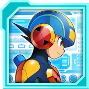
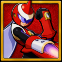
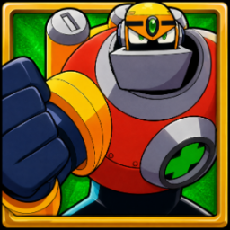
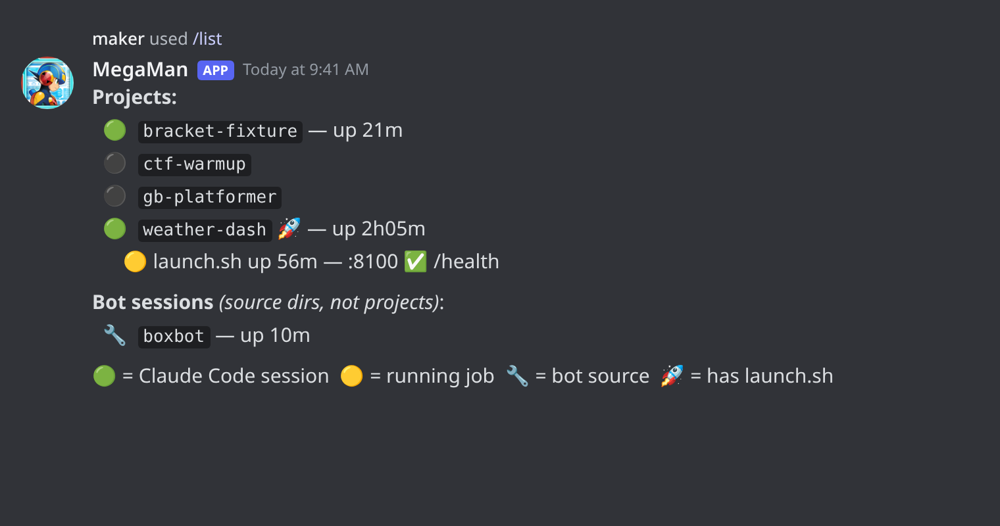
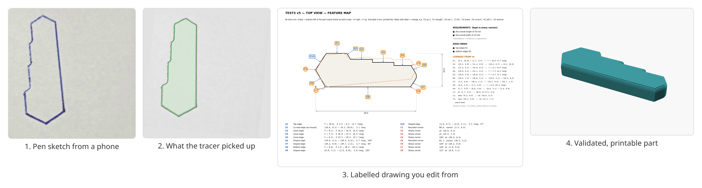
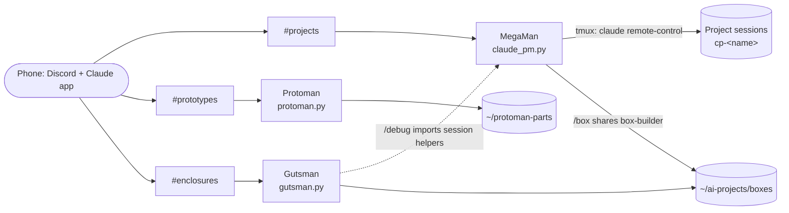

# Discord Bot Network

Three small Discord bots that turn a phone into a workshop. Run them on one Linux machine, give each its own channel in a private server, and you can start coding projects, design 3D-printable parts and build boxes without sitting at the computer.

| | Bot | Channel | One line | Docs |
|---|---|---|---|---|
|  | **MegaMan** | `#projects` | Runs Claude Code sessions for your projects and keeps the laptop healthy | [megaman/](megaman/README.md) |
|  | **Protoman** | `#prototypes` | Photo of a sketch in, validated STL + editable OpenSCAD out | [protoman/](protoman/README.md) |
|  | **Gutsman** | `#enclosures` | Answer a few questions, get a printable box with renders | [gutsman/](gutsman/README.md) |





## The Discord layout

One private server, one channel per bot. Each bot answers **only in its own channel**, so the three never talk over each other and you can mute or restrict them separately.

```
Your private server
├── #projects      ← MegaMan   /new /open /list /revive /run /mem /sudo ...
├── #prototypes    ← Protoman  /sketch /part ...  (post a photo, tap buttons)
└── #enclosures    ← Gutsman   /rugged /sliding /project /circular /inserts
```

Why separate bots and channels instead of one big bot?

- **Separate failure and permission domains.** MegaMan can start processes and root scripts on your machine; Protoman and Gutsman only read photos and write STL files. A bug or leaked token in the small bots doesn't hand over the machine.
- **Separate repos, lifecycles, restarts.** Redeploying Gutsman never kills a coding session MegaMan is hosting.
- **Each channel reads like one tool.** The command list is short, and the history is a log of that tool's work.

### How they relate



- **MegaMan is the only one that manages sessions.** Gutsman's optional `/debug` calls MegaMan's code, so a session opened on Gutsman's own source shows up in MegaMan's `/list` under *Bot sessions*.
- **Boxes are shared.** MegaMan's `/box` and Gutsman write to the same `boxes/` folder.
- **Protoman is standalone.** It has its own engine, Dockerfile and tests, and works without the other two. (The version in this repo has no `/debug` hook.)
- **Scaffolding flows from MegaMan.** `/new` stamps out `CLAUDE.md`, `RULES.md`, `PLAN.md`, `SKILLS.md`, `LOG.md` and `tools/setup.sh`, and copies a skill folder for types like OpenSCAD, KiCad or reverse engineering. Protoman's labelled-drawing code ships in the OpenSCAD skill.

## Repository layout

```
discord-bot-network/
├── README.md             this overview
├── docs/discord-setup.md Discord app, intents, invite and channel steps (read this first)
├── scripts/setup.sh      checks prerequisites, installs Python deps for all three
├── THIRD_PARTY.md        licenses of vendored content
├── megaman/              project manager (+ templates/, scaffolds/, examples/, box-builder/)
├── protoman/             sketch-to-part bot (+ engine/, Dockerfile, examples/)
├── gutsman/              box builder (+ box_types/, scad/, box-builder/)
└── tools/                scripts that produced the screenshots below
```

## Quick start

```bash
git clone <this repo> && cd discord-bot-network
./scripts/setup.sh            # checks python/tmux/openscad/claude, installs requirements
```

Then follow [docs/discord-setup.md](docs/discord-setup.md) to create the server, three applications and three channels, and:

```bash
(cd gutsman && python3 gutsman.py --setup && python3 gutsman.py)     # easiest first: only needs OpenSCAD
(cd protoman && cp .env.example .env && $EDITOR .env && python3 protoman.py --check)
(cd megaman  && python3 claude_pm.py --setup && python3 claude_pm.py)
```

Start with Gutsman or Protoman, since neither can touch your system. Add MegaMan when you want Claude Code sessions, and read its [security notes](megaman/README.md#security-notes) first.

Each bot has a systemd unit (`gutsman/boxbot.service`, `megaman/claude-pm.service`, `protoman/deploy/`) and Protoman also ships a Docker image.

## Requirements at a glance

| | MegaMan | Protoman | Gutsman |
|---|---|---|---|
| OS | Linux + systemd user services | Linux or Docker | Linux |
| Needs | tmux, Claude Code CLI (logged in) | OpenSCAD, Python libs (or Docker) | OpenSCAD 2023+, xvfb, admesh |
| Python | 3.10+ | 3.10+ | 3.10+ |
| Config | `~/.claude_pm.json` via `--setup` | `.env` | `~/.boxbot.json` via `--setup` |
| Tests | `python3 -m pytest -q megaman/tests` (256) | `cd protoman && python3 -m pytest -q` | `python3 -m pytest -q gutsman/tests` (108) |

## How the screenshots were made

No screenshots here are taken from a live Discord client, and no bot token was used to make them.

- **MegaMan and Gutsman** images come from running each bot's **real code** locally (`tools/record_megaman.py`, `tools/record_gutsman.py`): the real command handlers and wizards, the real OpenSCAD renders, with tmux and systemd lookups replaced by fixed demo values. `tools/render_chat.py` then draws the recorded text and pictures as a Discord-style chat. The wording and images are exactly what the bot produces; the styling only approximates Discord.
- **Protoman** images were rendered from the real channel history; its README explains the process and what was masked.
- The user is always shown as `maker`. Bot avatars are the bots' real Discord avatars (`tools/fetch_avatar.py` downloads a bot's own avatar; it never prints or stores the token). Real phone screenshots would be nicer: save them under the same filenames in each bot's `docs/images/`.

To regenerate: `python3 tools/record_gutsman.py rugged out field-kit cubby "6 of 40x30" go 25 go` then `python3 tools/render_chat.py out/transcript.json shot.png --bot Gutsman --avatar gutsman/docs/images/gutsman-avatar.png`.

## Safety

- Keep the server **private** and each bot in **one** channel.
- Tokens grant full control of a bot. Never commit them; the `.gitignore` here excludes the config files. If you ever paste one somewhere public, reset it in the Developer Portal.
- MegaMan deserves the most care: set `owner_user_id`, and consider the sudo gate.

## License

MIT for the code written for this project (see [LICENSE](LICENSE)). Vendored content keeps its own license, listed in [THIRD_PARTY.md](THIRD_PARTY.md):

- The rugged-box geometry (`*/box-builder/`) is **CC BY-SA 4.0**.
- ⚠️ `gutsman/scad/project_box.scad` (Gutsman's `/project` box) is **CC BY-NC-SA 4.0: non-commercial use only**.

MegaMan, Protoman and Gutsman are bot nicknames used as a personal homage; Mega Man and its characters are trademarks of Capcom. This project is not affiliated with or endorsed by Capcom.
