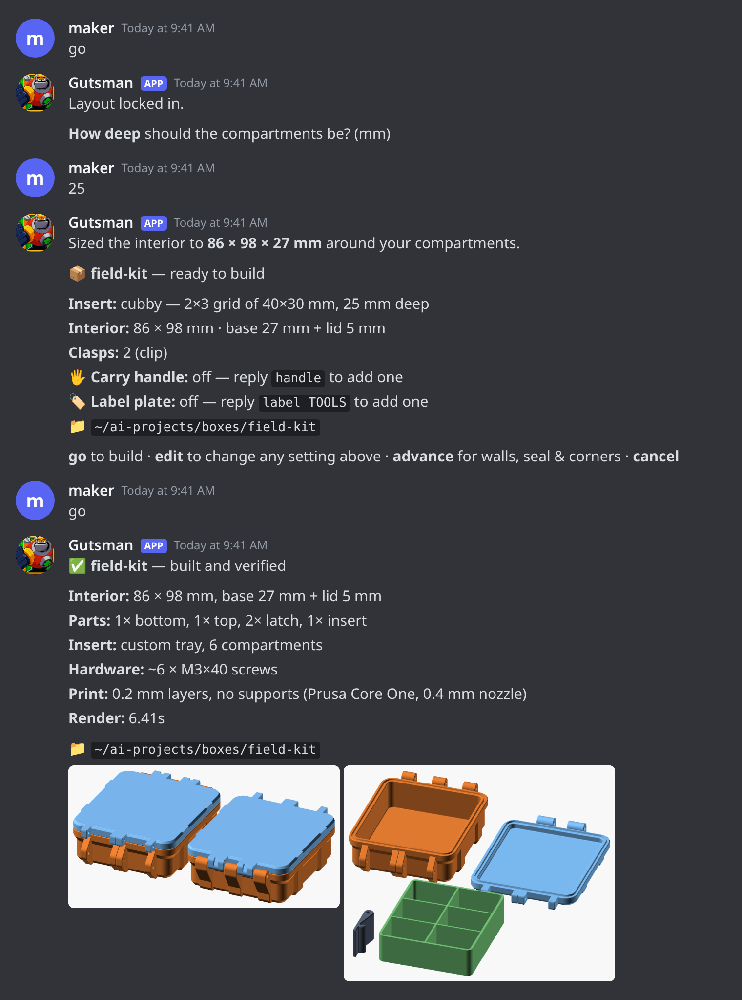
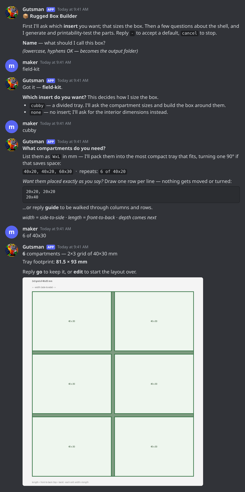
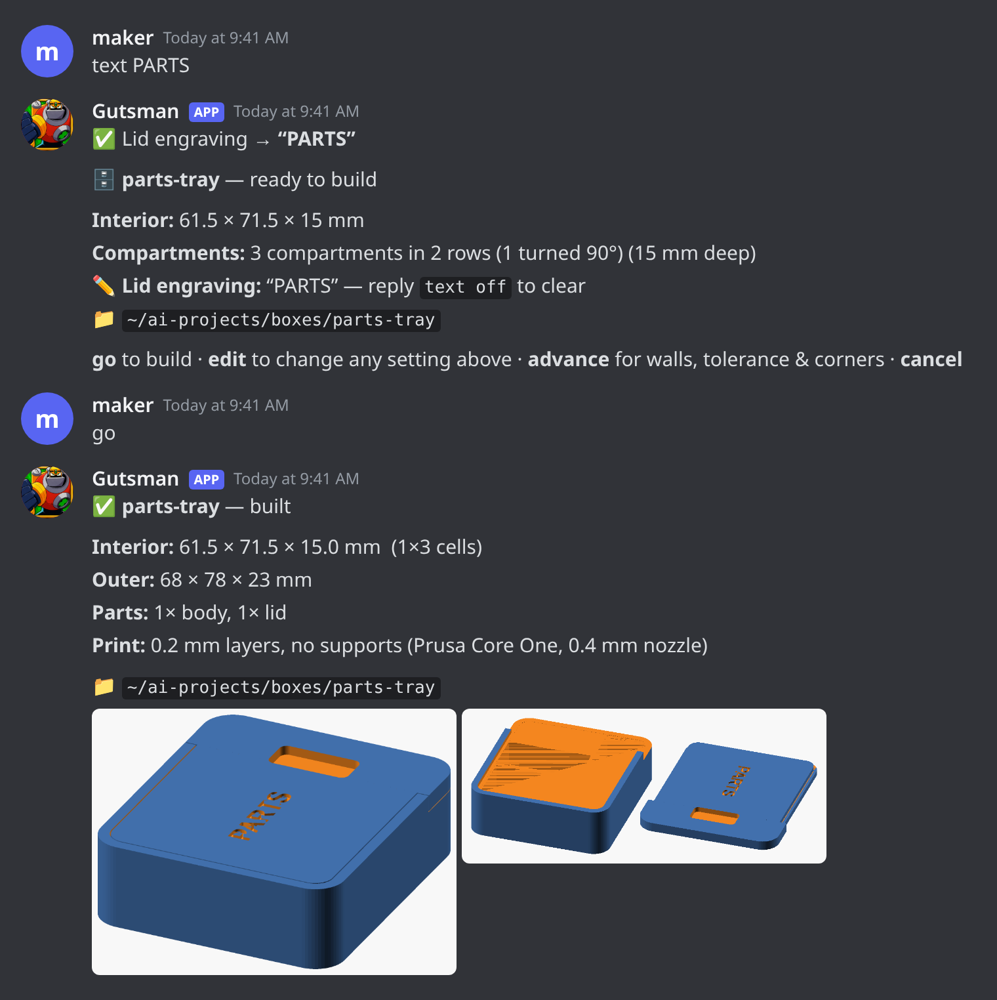

# BoxBot — "Gutsman"

A Discord bot that designs 3D-printable boxes from your phone. Pick a box type,
answer a few questions, get a folder of printable STLs and two renders.

Companion to **[MegaMan](../megaman/README.md)**. Gutsman only builds boxes.



*Real output from Gutsman's `/rugged` wizard and OpenSCAD, run locally. See [How the screenshots were made](../README.md#how-the-screenshots-were-made).*

```
/rugged      Rugged tool box — base + lid on a screwed hinge, with clasps
/sliding     Sliding-lid compartment box with an engraved lid
/project     Screw-close project/electronics box
/circular    Round box with a lip or screw lid
/inserts     A divided tray (cubby) sized for a box you already built
/cancel      Cancel the active wizard
/debug       Open/close a Claude Code session on Gutsman's own code
/boxhelp     What Gutsman can build
```

`/debug start` opens a Claude Code session on `~/BoxBot` so you can edit Gutsman
from your phone. The session is created through claude-pm's own helpers, so
**MegaMan sees and manages it like any other** — it appears in his `/list` under
*Bot sessions*, and `/url boxbot`, `/stop boxbot` and `/output boxbot` all work.
Restart Gutsman with `systemctl --user restart boxbot` after changing his code.

---

## Setup

Gutsman needs his **own** Discord bot application — he can't share MegaMan's.

1. **Create the application** at
   <https://discord.com/developers/applications> → *New Application* → name it
   `Gutsman`.
2. **Bot tab** → *Add Bot*. Under *Privileged Gateway Intents*, enable
   **MESSAGE CONTENT INTENT** — the wizards are driven by ordinary messages, so
   without this Gutsman sees nothing you type. Copy the **token**.
3. **OAuth2 → URL Generator** → scopes `bot` + `applications.commands`;
   bot permissions **Send Messages** and **Attach Files**. Open the generated
   URL and invite him to your server.
4. Make sure he can see your `#enclosures` channel (right-click it → Copy Channel ID; you paste that ID in step 5).
5. Configure and run:

```bash
cd ~/BoxBot
pip install -r requirements.txt
python3 gutsman.py --setup      # paste the token + channel id (config: ~/.boxbot.json)
python3 gutsman.py
```

Run it as a service instead:

```bash
cp boxbot.service ~/.config/systemd/user/
systemctl --user daemon-reload
systemctl --user enable --now boxbot
journalctl --user -u boxbot -f
```

### Host requirements

| Requirement | Why | Install |
|---|---|---|
| **OpenSCAD 2023+** | renders the geometry; the Manifold backend makes a box ~7 s instead of ~5 min | `sudo bash box-builder/scripts/install-openscad-global.sh` |
| **Python 3** + `trimesh`, `numpy`, `shapely`, `pillow` | mesh maths for the renders | `pip install -r requirements.txt` |
| **admesh** | slicer-grade printability check | `sudo dnf install admesh` |
| **xvfb** | lets OpenSCAD render with no desktop session | `sudo dnf install xorg-x11-server-Xvfb` |

Without OpenSCAD or trimesh the STLs are still generated — you just get a
warning instead of the pictures.

---

## Using it



Interior-first: you list the compartments you want (`6 of 40x30`, or `40x20, 40x20, 60x30`) and Gutsman builds the box around them. The other box types work the same way, for example `/sliding`:



`/rugged` starts the wizard. Reply `-` to any question to accept the default,
`cancel` to stop.

```
Name             what to call the box (becomes the folder)
Width            interior, side-to-side, 20–300 mm
Length           interior, front-to-back, 20–300 mm
Base depth       interior, 0–300 mm
Lid depth        interior, 0–300 mm
Clasps           auto / 1 / 2   (auto lets the engine pick from the box size)
Clasp style      clip / draw    (draw adds ~20 s)
Handle           needs a 2-clasp box
Label            needs a 2-clasp box; asks for the text if enabled
```

At the summary you get four ways out:

- **go** — build it
- **edit** — numbered table of your answers; `<number> <value>` to change one,
  `done` to return. You can rename the box from row 1.
- **advance** — the remaining engine options (lip seal, corner radius,
  reinforced corners, lid grip, wall/lip thickness), same `<number> <value>`
  interaction
- **cancel**

It finishes with the folder path and two pictures: the assembled box shown from
both the hinge and the clasp side, and every part laid out flat as it goes to
the slicer.

Boxes land in `~/ai-projects/boxes/<name>/` alongside `manifest.json` and the
two PNGs. Every build is printability-tested (watertight, no stray shells,
dimensions as asked, halves that mate); if the tests fail Gutsman says so and
tells you not to print it.

---

## Adding a box type

Each box type owns its own wizard — there's no shared questionnaire to squeeze
a new shape into.

1. Write `box_types/<name>.py` with `COMMAND`, `TITLE`, `DESCRIPTION` and a
   `Wizard` class (subclass `wizard_base.BaseWizard`, implement `start()` and
   `async step()`). `step()` returns a string, or `(text, [png_paths])` at the
   end.
2. Add the module to `TYPES` in `box_types/__init__.py`.

The command appears automatically. `render.py` has the reusable parts —
headless OpenSCAD, parts-grid layout, framing and cropping — so a new type
mostly writes its own questions plus however its parts fit together.

> **Command names must be lowercase** and match `[a-z0-9_-]{1,32}`; Discord
> rejects anything else. That's why it's `/rugged`, not `/ruggedBox`.

---

## `/debug` is optional

`/debug start` opens a Claude Code session on this folder through [MegaMan](../megaman/README.md)'s session helpers. It looks for `../megaman` (this repo's layout), then `~/claude-pm`, or the folder in `claude_pm_dir` in `~/.boxbot.json`. If MegaMan isn't installed, `/debug` says so and everything else works.

## Licenses and attribution

Gutsman's own code is MIT. Two parts are not:

> ⚠️ **`/project` boxes are non-commercial only.** `scad/project_box.scad` is
> adapted from pbtec's "Easy Project Box" and is licensed **CC BY-NC-SA 4.0**.
> Don't sell the file or boxes made from it, keep the credit, and share changes
> under the same license. Details: [`scad/project_box.LICENSE.md`](scad/project_box.LICENSE.md).

Geometry for the rugged box comes from
**[smkent/monoscad](https://github.com/smkent/monoscad) "rugged-box"** by
smkent / bulbasaur0, licensed **CC BY-SA 4.0** — keep that attribution on
anything you redistribute, and share changes under the same license. See
`box-builder/NOTICE`.

The full table is in [../THIRD_PARTY.md](../THIRD_PARTY.md).
