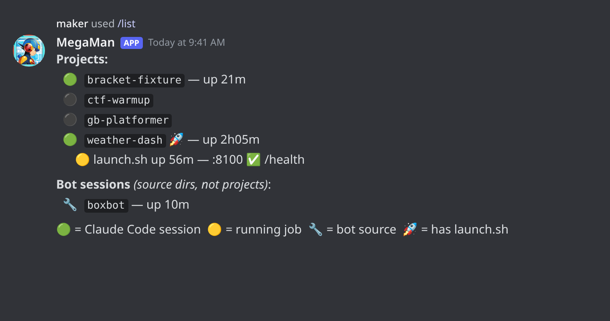
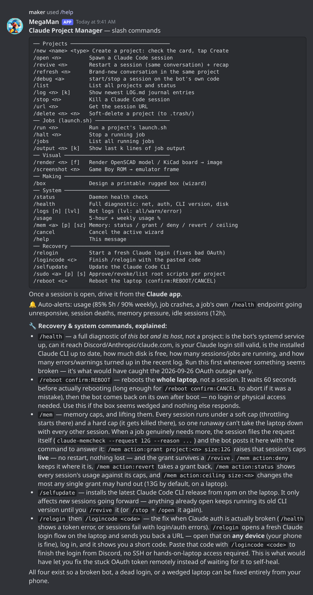
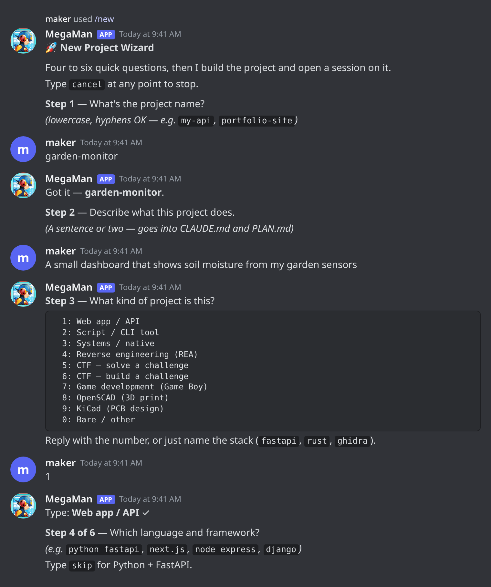
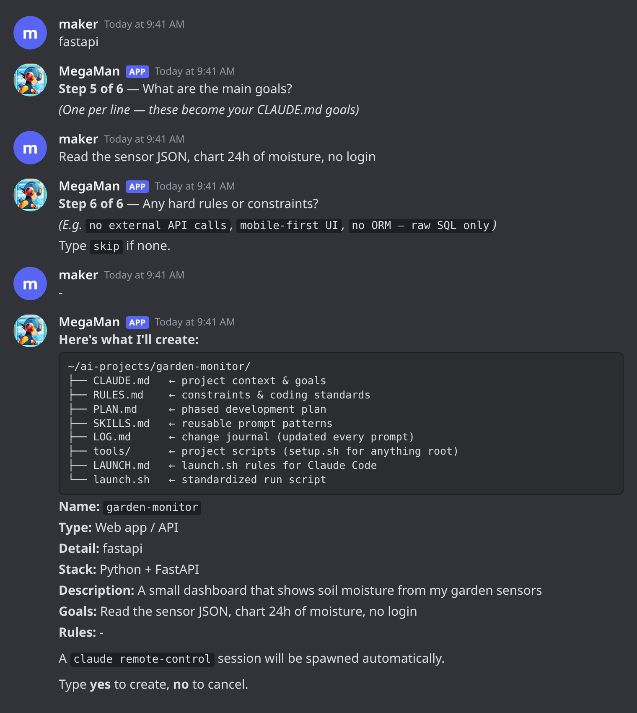

# MegaMan: the project manager

**Run Claude Code on your laptop and drive it from your phone.** MegaMan is a Discord bot that creates projects, starts a `claude remote-control` session for each one inside tmux, and keeps the machine healthy while those sessions work. You open the session from the Claude app and talk to it there; Discord is the control panel around it.



*Output from MegaMan's real `/list` handler, run against a demo projects folder. See [How the screenshots were made](../README.md#how-the-screenshots-were-made).*

## What it does

| Job | Commands |
|---|---|
| **Create projects** from a short card or wizard, filling `CLAUDE.md`, `RULES.md`, `PLAN.md`, `SKILLS.md`, `LOG.md` (and `LAUNCH.md` + `launch.sh` for runnable projects) from `templates/` | `/new` |
| **Run a session per project** in tmux and hand you its URL | `/open` `/url` `/stop` `/list` |
| **Recover sessions** with a "where we left off" recap, or start a clean conversation | `/revive` `/refresh` |
| **Run project servers** (`launch.sh`) as jobs you can tail | `/run` `/halt` `/jobs` `/output` |
| **Render things** | `/render` (OpenSCAD, KiCad), `/screenshot` (Game Boy ROM) |
| **Design a printable box** from the vendored generator | `/box` |
| **Protect the laptop** with per-session memory caps, a shared ceiling and a request/grant flow | `/mem`, `claude-memcheck` |
| **Gate root** so only scripts you approved (pinned by SHA-256) can use `sudo` | `/sudo` |
| **Recover remotely** | `/health` `/status` `/logs` `/usage` `/relogin` `/selfupdate` `/reboot` |



## Creating a project

`/new` asks four to six questions, computed from the project type. Launch type and sudo scaffolding are inferred, never asked. (The live bot now shows a tap-through card for the same data; the wizard below is the same flow in plain messages.)





The files that run produces are checked in at [`examples/garden-monitor/`](examples/garden-monitor): read its `CLAUDE.md`, `RULES.md` and `launch.sh` to see exactly what a fresh session is given.

### Project types and their scaffolds

Some types ship a skill folder (`scaffolds/`) that is copied into the project so the session starts with a playbook, not a blank page. See [`scaffolds/README.md`](scaffolds/README.md).

| Type | Scaffold |
|---|---|
| OpenSCAD (3D print) | `scaffolds/3d-modeling/printable-parametric-parts` |
| Game Boy (GBDK) | `scaffolds/gbdk/gameboy-dev` |
| KiCad (PCB) | `scaffolds/kicad/pcb-design` |
| Reverse engineering (REA) | `scaffolds/re/reverse-engineering` |
| CTF authoring | `scaffolds/ctf/challenge-authoring` |

## Requirements

- Linux with **systemd user services** and **tmux** (developed on Fedora)
- **Python 3.10+** and `discord.py` (`pip install -r requirements.txt`)
- The **Claude Code CLI**, logged in (`claude auth login`), with Remote Control available on your plan
- Optional: OpenSCAD (for `/render`, `/box`), KiCad, GBDK, the REA harness; each is only needed by the project type that uses it (`install-optional.sh`, `install-kicad.sh`, `install-rea-android.sh`)

## Setup

1. **Create the Discord application** (see [docs/discord-setup.md](../docs/discord-setup.md)): bot token, *Message Content* intent, `bot` + `applications.commands` scopes.
2. **Install and configure:**
   ```bash
   cd megaman
   pip install -r requirements.txt
   python3 claude_pm.py --setup      # token, channel ID, projects folder
   python3 claude_pm.py              # run it in the foreground first
   ```
3. **Keep it running** as a user service:
   ```bash
   mkdir -p ~/.config/systemd/user
   cp claude-pm.service ~/.config/systemd/user/
   # edit ExecStart if you did not clone to ~/claude-pm
   systemctl --user daemon-reload
   systemctl --user enable --now claude-pm
   loginctl enable-linger "$USER"     # so it survives logout
   journalctl --user -u claude-pm -f
   ```
4. **Optional: the sudo gate.** `sudo bash install-sudo-gate.sh` installs `/usr/local/sbin/cpm-sudo` and a narrow sudoers file for your account. It also lists any blanket `NOPASSWD: ALL` grants, which would defeat the gate. Skip this if you are happy for sessions to inherit your sudo.

Config lives in `~/.claude_pm.json` (created by `--setup`, git-ignored), logs in `~/.claude_pm.log`. Projects land in `~/ai-projects/<name>/`.

## How it is put together

```
Discord message
  → on_message (wizard answers) or a slash command
  → CommandHandler method (_open, _list, _revive, ...)
  → spawn_session() / revive_session()
  → tmux new-session running `claude remote-control --name <project>`
```

- `claude_pm.py` is the whole bot in one file; `tests/test_sessions.py` has 256 tests (`python3 -m pytest -q tests`).
- **Session names:** Claude sessions are `cp-<project>`, job sessions `job-<project>`.
- **`/revive` vs `/refresh`:** a restarted `remote-control` reattaches to the conversation named in `~/.claude/projects/<dir>/bridge-pointer.json`. `/revive` keeps that pointer (same conversation); `/refresh` moves it aside to get a new one.
- **Memory caps are a soft block.** Each session runs in its own systemd scope (defaults 6G soft / 10G hard, shared ceiling for the slice). A session that needs more runs `claude-memcheck --request 12G --reason "..."`; the bot posts it, you tap `/mem action:grant`, and the cap is raised on the running scope with no restart. `templates/GLOBAL_RULES.md` and `templates/claude-memcheck` are installed into `~/.claude/` at every start so every session knows the rules. Edit the templates, not the installed copies.
- **Root is gated.** `templates/cpm-sudo` allows a session to run only a project script you approved from Discord, and only if its hash still matches.
- **No model is forced.** The bot never sets `ANTHROPIC_MODEL`; the model is whatever your Claude app uses.
- **Other bots can borrow the session code.** [Gutsman](../gutsman/README.md) imports `kill_session`, `load_config`, `session_exists`, `session_name`, `spawn_session` and `trust_workspace` for its own `/debug`. Keep those signatures stable.

## Making it yours

- Edit `templates/*.template` to change what every new project starts with.
- Add a project type: add a row to `STACKS`, a follow-up question in `STACK_DETAIL_QUESTIONS` if needed, and (optionally) a scaffold folder registered in `_ASSETS`'s map near line 195.
- Tune caps in `~/.claude_pm.json`: `session_mem_high`, `session_mem_max`, `sessions_total_mem_high`, `mem_grant_ceiling`.

## Security notes

MegaMan can start processes and (with the gate off) root on your machine from a Discord message. Keep the bot in a **private server**, in **one private channel**, and set `owner_user_id` so only you can use it. The token in `~/.claude_pm.json` is a password to your laptop: never commit it.
