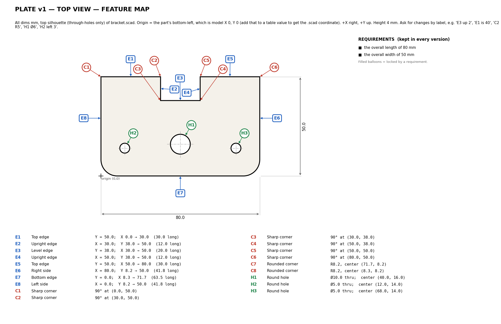
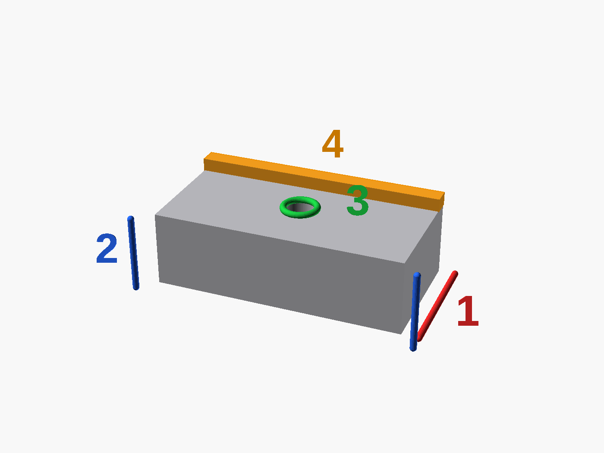

# Project skills and rules

Every project MegaMan creates with `/new` starts with a small set of Markdown files that tell the Claude Code session how to behave: what to log, what it may touch, how the work is phased, and what "done" means for that kind of work. Some project types also get a **skill**: a playbook plus working scripts, copied into the project.

This page explains all of it. Part 1 covers what every project gets. Part 2 covers what each project type adds.

- [Part 1: what every project gets](#part-1-what-every-project-gets)
  - [`LOG.md`: the change log](#logmd-the-change-log-hard-rule)
  - [`RULES.md`: the constraints](#rulesmd-the-constraints)
  - [`PLAN.md`: the phased plan](#planmd-the-phased-plan)
  - [`SKILLS.md`: prompt patterns and the type's playbook](#skillsmd-prompt-patterns-and-the-types-playbook)
  - [`CLAUDE.md`: the entry point](#claudemd-the-entry-point)
  - [`tools/setup.sh` and the sudo gate](#toolssetupsh-and-the-sudo-gate)
  - [`LAUNCH.md` and `launch.sh`](#launchmd-and-launchsh-runnable-projects)
  - [Global rules: memory, images, staying local](#global-rules-memory-images-staying-local)
- [Part 2: what each project type adds](#part-2-what-each-project-type-adds)
  - [OpenSCAD (3D print)](#openscad-3d-print)
  - [KiCad (PCB design)](#kicad-pcb-design)
  - [Game Boy (GBDK)](#game-boy-gbdk)
  - [Reverse engineering](#reverse-engineering)
  - [CTF: build a challenge](#ctf-build-a-challenge)
  - [CTF: solve a challenge](#ctf-solve-a-challenge)
  - [Web, Script, Native and Bare](#web-script-native-and-bare)
- [Adding or changing a skill](#adding-or-changing-a-skill)

The templates live in [`../templates/`](../templates/), the skills in [`../scaffolds/`](../scaffolds/), and a real generated project in [`../examples/garden-monitor/`](../examples/garden-monitor/).

---

## Part 1: what every project gets

| File | Job | Who reads it |
|---|---|---|
| `LOG.md` | Change log: what changed and why, newest first | The session, at the start of every conversation |
| `RULES.md` | Hard constraints: logging, sandbox, git, code quality, testing | The session, before it changes anything |
| `PLAN.md` | The work in three phases, plus open questions | You and the session |
| `SKILLS.md` | Prompt patterns you can paste, then the type's playbook | You (patterns) and the session (playbook) |
| `CLAUDE.md` | Entry point: stack, goals, folder limits, links to the rest | Claude Code loads it automatically |
| `tools/setup.sh` | The one place root-only work goes | You approve it, the session runs it |
| `LAUNCH.md`, `launch.sh` | How the bot starts and monitors the program | Runnable projects only |

### `LOG.md`: the change log (hard rule)

A Claude session forgets everything when the conversation ends. `LOG.md` is what carries a project from one session to the next, so the rule is strict and it appears in both `CLAUDE.md` and `RULES.md`:

- **After every prompt that changes anything, the session adds an entry before it finishes its reply.** Questions and discussion need no entry.
- **Newest entry at the top.**
- Each entry has:
  - a timestamp (`YYYY-MM-DD HH:MM`, local) and a short title
  - a summary of what changed **and why**: the intent, not a diff
  - the list of files created, edited or deleted
- **The session reads `LOG.md` first** when a conversation starts.

Git records what changed. `LOG.md` records why, what was tried and dropped, and what state the work was left in. A new session reads it and picks up where the last one stopped.

The file starts with one entry, written by `/new`:

```markdown
## 2026-11-05 — Project created

Scaffolded by the project wizard: CLAUDE.md, RULES.md, PLAN.md, SKILLS.md, tools/setup.sh, LAUNCH.md, launch.sh.
No code yet — see PLAN.md Phase 1 for where to start.

**Files:** CLAUDE.md, RULES.md, PLAN.md, SKILLS.md, LOG.md, tools/setup.sh, LAUNCH.md, launch.sh
```

Several skills use the log for more than change notes: a KiCad project lists every part number there before any schematic work, a reverse-engineering project records the target's SHA-256 there, and a 3D-print project records which estimated dimensions turned out wrong and by how much. The bot's `/log` command posts the latest entries to Discord.

### `RULES.md`: the constraints

Six sections. The first three are the same in every project; the next two are filled in per project type (see Part 2); the last holds whatever you typed into the "rules" question.

| Section | What it says |
|---|---|
| **Change Log** | The `LOG.md` rule above |
| **Sandbox** | The session works only inside the project folder: no parent folders, no sibling projects, no network calls unless told to |
| **Git** | Never commit to `main` directly; use feature branches; messages as `type: short description`; small commits |
| **Code Quality** | Per type. Python gets PEP 8 and type hints; OpenSCAD gets nozzle and clearance rules; KiCad gets decoupling and ground-pour rules |
| **Testing** | Per type: what counts as the test gate. `pytest` for Python, a clean `make` for Game Boy, ERC + DRC for KiCad, mesh validation for OpenSCAD |
| **Project-Specific Constraints** | Your own rules from `/new` |

### `PLAN.md`: the phased plan

Every project gets the same shape: an overview, three phases, and a list of open questions.

```markdown
## Overview
## Phase 1 — Foundation
## Phase 2 — Core Features
## Phase 3 — Polish & Deploy
## Open Questions
```

The phases are filled in three ways:

1. **Types with a known method get that method.** CTF solving, reverse engineering and CTF authoring each have fixed phases (shown in Part 2).
2. **If you supplied plan lines**, they are split into thirds across the three phases.
3. **Otherwise the default:** set up structure and tooling → build core features → polish, test, deploy.

The session works through the plan phase by phase and adds to Open Questions as it finds things only you can answer.

### `SKILLS.md`: prompt patterns and the type's playbook

Two halves.

**Prompt patterns** are fill-in-the-blank prompts you can paste into the Claude app so that common requests are phrased the same way every time:

| Pattern | What it asks for |
|---|---|
| Add a New Feature | Name, behaviour, acceptance criteria; follow existing patterns; tests first |
| Fix a Bug | Where, what happens, what should happen; check for the same bug elsewhere |
| Write Tests | Happy path, edge cases and error cases in the project's test framework |
| Code Review | Correctness, coverage, consistency, `RULES.md` violations, merge blockers |
| Refactor | A stated goal, with no change in external behaviour |
| Deploy | Full test run first, then build, deploy and confirm health |
| Something needs root | Put it in `tools/setup.sh` and give you the one-line summary to approve |

**Project-Specific Skills** is where the project type's playbook goes. For the five types with a skill folder, the folder's `SKILL.md` is placed in `SKILLS.md` and everything else in the folder (scripts, a Makefile, starter directories) is copied into the project root. Part 2 describes each one.

### `CLAUDE.md`: the entry point

Claude Code loads this file by itself at the start of every conversation, so it is short and points at the others. It holds the project description, the stack, a quick start, your goals, the folder confinement rule, the `LOG.md` rule again, the root-access rule, and a "Notes" block with type-specific pointers (for example, which script is the test gate).

### `tools/setup.sh` and the sudo gate

Sessions have no general root access. Anything that needs root (installing a package, a udev rule, mounting an image) goes into `tools/setup.sh`, which must be short, idempotent, commented and limited to the root-only work. You approve it once from Discord:

```
/sudo action:approve project:<name> script:tools/setup.sh
```

The approval is pinned to the file's hash, so editing the script cancels it. Every project gets this file and this rule, whether or not it ever needs root.

### `LAUNCH.md` and `launch.sh` (runnable projects)

Web, Script, Native, reverse-engineering and Game Boy projects also get a launch contract, so the bot's `/run`, `/halt`, `/jobs` and `/output` commands work on any of them the same way:

- `launch.sh` starts with `#!/usr/bin/env bash` and `set -euo pipefail`.
- All output is appended to `launch.log` in the project folder.
- `PORT` is always set (`0` if the program has no network port).
- The final command uses `exec`, so the bot can track the process.
- No backgrounding (`&`, `nohup`); the bot runs it in tmux.
- Web services answer `GET /health` with HTTP 200.

### Global rules: memory, images, staying local

One more file applies to every session on the machine, not just one project: [`templates/GLOBAL_RULES.md`](../templates/GLOBAL_RULES.md), which the bot installs into `~/.claude/CLAUDE.md` each time it starts.

- **Memory.** Each session runs under a memory cap. Before anything heavy (a build, an emulator, a mesh boolean, a Ghidra analysis) it runs `claude-memcheck`, which answers `OK`, `CAUTION` or `STOP`. A job that needs more files a request with a size and a reason (`claude-memcheck --request 12G --reason "..."`), you grant it from Discord with `/mem`, and the cap is raised on the running session.
- **One heavy thing at a time**, with limits on what is launched (`make -j2`, capped Gradle and emulator memory), and clean-up of daemons afterwards.
- **Root** goes through the `/sudo` gate described above.
- **Work stays in the project folder.** Images are shown by reading the file so they appear in the Claude app; `claude-share` posts files to Discord when you ask.

---

## Part 2: what each project type adds

| `/new` type | Skill folder | Test gate |
|---|---|---|
| OpenSCAD (3D print) | `scaffolds/3d-modeling/printable-parametric-parts` | Mesh validation on every export |
| KiCad (PCB design) | `scaffolds/kicad/pcb-design` | ERC + DRC clean |
| Game development (Game Boy) | `scaffolds/gbdk/gameboy-dev` | `make` builds a working ROM |
| Reverse engineering (REA) | `scaffolds/re/reverse-engineering` | Recompile + differential test, per function |
| CTF: build a challenge | `scaffolds/ctf/challenge-authoring` | Reference solver runs end to end |
| CTF: solve a challenge | none (rules and plan only) | The flag |
| Web / Script / Native / Bare | none (rules only) | The language's test framework |

### OpenSCAD (3D print)

Skill: [`printable-parametric-parts`](../scaffolds/3d-modeling/printable-parametric-parts/SKILL.md). The largest skill, because a part that looks right on screen can still fail to print, fail to fit, or fail to load in the slicer.

**Rules written into `RULES.md`**

- Every dimension is a named variable at the top of the file; everything else is derived from those.
- One module per part, small named modules per feature.
- The printer is assumed to be a 0.4 mm nozzle machine: walls in multiples of 0.4 mm, no feature under 0.8 mm.
- Layer height is 0.15, 0.2 or 0.28 mm. The session picks one and says which.
- Mating surfaces get 0.1 mm clearance per side unless a comment says why not.
- Binary STL only, never ASCII.
- A `v#` version mark is engraved on a hidden face every revision.
- Test gate: `./scripts/export_and_validate.sh model.scad Module out.stl` must pass after every export.

**The ten golden rules** (short form)

1. Export binary STL. ASCII files can be rejected by slicers as corrupt.
2. A joint the user has confirmed is frozen. Unrelated changes do not touch its numbers.
3. Render before shipping: an overall view and a cross-section of every internal feature.
4. Validate the mesh on every export.
5. Design for the print: orientation, overhangs, bridges and minimum thicknesses.
6. Stamp `v#` on each part, once, on solid material.
7. Never leave two faces on the same plane; that is what breaks booleans.
8. Round corners with real arcs, not stamped circles or `offset` tricks on thin features.
9. When copying a real object, ask for measurements with a coloured picture (below).
10. Set `$fa`/`$fs` inside the part module, or exports through a wrapper come out coarse.

**Scripts copied into the project (`scripts/`)**

| File | What it does |
|---|---|
| `lib.scad` | Tested modules: rounded bodies, dovetail grooves and tongues with lead-ins, cantilever clips, engraving, logo deboss |
| `example.scad` | A working two-part dovetail assembly to start from |
| `export_and_validate.sh` | Exports one part to binary STL and runs the validation gate |
| `validate_stl.py` | The gate: binary format, watertight, single body, slivers, admesh holes |
| `feature_map.py` + `feature_map_engine/` | The labelled engineering drawing (below) |
| `make_drawings.py` | Multi-view dimensioned sheets with a joint detail and parameter table |
| `measure_lib.scad`, `measure_example.scad`, `render_measure.sh` | The measurement-request picture (below) |
| `trace_logo.py`, `stamp_logo.py` | Turn a PNG into an SVG, and deboss a logo onto any STL |

#### How a CAD project produces its engineering drawing

The drawing is called a **feature map**. It is made from the exported mesh, not from the source code, so it shows what will actually be printed.

```bash
python3 scripts/feature_map.py part.scad drawings/v1 --module plate
```



What the script does:

1. Exports the named module to STL (or takes an STL directly).
2. Takes the part's top silhouette: the outline and any through-holes.
3. Splits the outline into features and gives each a balloon: **E#** for edges (blue), **C#** for corners (red), **H#** for holes (green).
4. Draws the part with overall dimensions and the origin (the part's bottom-left corner).
5. Adds a table with each feature's exact geometry, for example `E3  Level edge  Y = 38.0; X 30.0 → 50.0 (20.0 long)` or `H1  Round hole  Ø10.0 thru; center (40.0, 16.0)`.
6. Writes `feature_map.png`, `feature_map.pdf` and `features.json` (the same data, machine-readable).

The point of the labels is that you can ask for changes without describing geometry in words:

> E3 up 2, H1 Ø6, C2 R5

The session then:

1. matches each label to the parameter that drives it, using the table row;
2. changes the parameter (never a one-off offset), re-exports and re-validates;
3. regenerates the drawing with the next `--version` in its own folder, shows it, and says which numbers changed.

Labels can renumber when the outline changes shape, so changes are always given against the newest drawing.

Options:

| Flag | Use |
|---|---|
| `--version 3` | Puts the revision in the title |
| `--module lid` | Draws one part of a multi-part `.scad` file |
| `--symmetry lr\|tb\|both` | Labels one side of a symmetric part; mirrored features change together |
| `--z 2.4` | Draws a section at that height, to show blind pockets, slots and bosses that the top silhouette hides |

Limits: one body per drawing, and values are exact to 0.1 mm for parts up to about 400 mm long. A hole that reads slightly under its nominal size (Ø18.9 for a 19 mm hole) means the circle is faceted too coarsely, which rule 10 fixes.

The drawing code is the same engine [Protoman](../../protoman/README.md) uses for his parts, vendored into the skill, so drawings from any project look and read the same. For multi-view sheets with sections and a joint detail, `make_drawings.py` is the separate tool.

#### Copying a real object: the measurement-request picture

When the job is to copy a physical part from photos or a traced outline, photos give proportions but not reliable sizes. The skill makes this a conversation in rounds:

1. **Rank the evidence.** A 1:1 trace is trusted for the outline; photo-derived numbers are not.
2. **Tag every dimension** in the `.scad` file: `[M]` measured, `[P]` from a photo, `[?]` guess.
3. **Build the whole model anyway** from the best estimates.
4. **Render a measurement request**: the model in grey, with each unknown drawn on it as a coloured, numbered marker.
5. **Send the picture with a matching numbered list**: what is assumed now and exactly what to measure.
6. **Apply the answers**, change those tags to `[M]`, re-export, and log which estimates were wrong and why.



You answer by number: `1. 26mm  2. remove  3. water ring, remove`. The markers also ask whether a feature exists at all, because mould marks and water rings look like holes and recesses in photos.

**Mesh validation gate.** All three must pass before a file is handed over: OpenSCAD's CGAL summary (`Simple: yes`), `admesh` (no disconnected facets, no holes), and `trimesh` (watertight, one body). A failure is fixed in the source geometry, not by repairing the mesh.

### KiCad (PCB design)

Skill: [`pcb-design`](../scaffolds/kicad/pcb-design/SKILL.md), for KiCad 9 driven headlessly through `kicad-cli`.

**Golden rules**

1. **ERC + DRC clean is the test gate.** `./scripts/pcb_check.sh` runs both and renders the board. Violations are fixed or waived in `LOG.md`, never left open.
2. **Schematic before layout.** The schematic is finished, ERC-clean and has every footprint assigned before routing starts.
3. KiCad files are plain text and can be read or edited directly, but the check script runs after every direct edit.
4. **Design to the fab's real limits from day one**, set in Board Setup so DRC enforces them.
5. **Every IC power pin gets a 100 nF capacitor within 2 mm**, plus a bulk capacitor per rail.
6. **Ground pour on both layers**, stitched with vias, not cut into slivers by signals.
7. **Board name, version and date on the silkscreen** every revision.

**Fab defaults** (JLCPCB 2-layer, 1.6 mm): 0.25 mm signal traces, 0.5–1.0 mm power traces, 0.2 mm clearance, 0.6/0.3 mm vias, 0.3 mm from trace to board edge, silkscreen text 1.0 mm or taller.

**Workflow:** parts and datasheets (exact part numbers listed in `LOG.md`) → schematic → ERC → footprints → placement, then routing → DRC → render and inspect → gerbers. DRC is run again immediately before every gerber export. The bot's `/render` command posts the board image to Discord.

The skill also lists the `kicad-cli` commands, how to script boards with `pcbnew`, and common traps (pin 1 mismatches, mirrored bottom-side connectors, two ground nets with nearly the same name).

### Game Boy (GBDK)

Skill: [`gameboy-dev`](../scaffolds/gbdk/gameboy-dev/SKILL.md), for C compiled with GBDK-2020. It ships a `Makefile` and a starter `src/`.

**Golden rules**

1. **`make` always produces a working ROM.** The build is the test gate.
2. **Budget the hardware in writing.** 40 sprites total and 10 per scanline, 8 KB of video memory, 8 KB of work memory, 32 KB of ROM without banking. Each spend is noted in a comment where it happens (`// sprites: 12/40 used`).
3. **No floats, no `malloc`.** Movement uses 8.8 fixed point; all memory is static.
4. **Graphics go through `png2asset`.** The PNG is the source of truth; tile bytes are not hand-written.
5. **One game-loop pass per frame**, tied to `vsync()`. Video memory is touched only during vertical blank.
6. **Plan ROM banking early**, at about 24 KB, not when the ROM overflows.
7. **Test under original Game Boy rules** (four shades) even when targeting Color.

`RULES.md` adds zero compiler warnings, a ROM-size check after every build, and a look in an emulator after any gameplay change. The skill closes with patterns for input, random seeding, scanline effects and music.

### Reverse engineering

Skill: [`reverse-engineering`](../scaffolds/re/reverse-engineering/SKILL.md). It has two halves: the REA tool harness (Ghidra, Frida, JADX and binary inventory behind one interface, registered for that project only) and a verification discipline.

**Scope.** Only artifacts you own or are authorised to analyse, for understanding, porting, interoperability, security review and preservation. Not for stripping protection to redistribute.

**Evidence discipline.** Every claim is labelled with one of four buckets:

| Bucket | Meaning |
|---|---|
| Observed | A tool produced it: bytes, a trace, a test result |
| Derived | Computed from an observation by a stated rule |
| Inferred | A hypothesis that fits the evidence |
| Unknown | Not known, and said so |

Evidence is cited as file, address and the call that produced it. "The decompiler says" is not a citation.

**Workflow and plan phases**

```
triage → inventory → static model → dynamic ground truth → recompile → differential test → ledger
```

| Phase | Work |
|---|---|
| 1 | Triage (format, architecture, packing, encryption, protections); inventory everything into `analysis/`; record the target's SHA-256 in `LOG.md` |
| 2 | Static model (decompile, type, name); run the original to capture what static analysis can only guess; feed those facts back |
| 3 | Recompile and differential-test; fill the ledger; check the checker |

**"Decompiled" is not a result.** A function counts as recovered only when it has been recompiled alone and run against the original from the same captured state with the same outcome. Each function gets a verdict in a ledger file (proven, audited by hand, or untestable and why). The test harness is itself tested: coverage audit, rebuild from scratch, and deliberately injected defects that it must catch.

**Reporting.** A reply that finishes work ends with a percent-complete figure regenerated from the ledger, with its denominator, and a numbered list of next steps.

**Layout:** `target/` (the artifact), `analysis/` (everything tools produce), `recovered/` (recovered source and data), `tools/` (project scripts). The skill also carries notes for older 32-bit ARM iOS binaries and the memory rules for long Ghidra runs.

### CTF: build a challenge

Skill: [`challenge-authoring`](../scaffolds/ctf/challenge-authoring/SKILL.md), with `build/` and `solve/` folders.

1. **Write the solution first.** The intended path step by step, the single insight the challenge is about, and what the solver sees first. The reference solver (`solve/solve.py`) is part of the deliverable and must run end to end from a clean environment.
2. **Flag hygiene.** One flag in the event's format, defined in one place, injected at build time, and not recoverable with `strings`, `xxd` or `grep`.
3. **Hunt unintended solutions.** Attack the challenge as a player would: leaked paths and symbols, shortcuts around the insight, what else is reachable on the host. Each one found goes in `notes.md` as fixed or accepted, with the reason.
4. **Calibrate difficulty by number of insights** (easy, medium, hard, brutal) and write a three-step hint ladder: nudge, direction, near-spoiler.
5. **Build and hand off.** A deterministic build, a stripped artifact, and a package with the artifact, README, flag, solver, hints, deploy instructions and known unintended paths.
6. **Playtest** with someone who does not know the answer. If nobody has, the hand-off says so.

The plan phases follow the same order: design and prototype → build, solve and hunt → strip, package and playtest.

### CTF: solve a challenge

No skill folder; the method is in `RULES.md` and `PLAN.md`. The session keeps a running `notes.md` and puts challenge files in `assets/`.

| Phase | Work |
|---|---|
| 1 | Inventory every file; first pass with `file`, `strings`, `xxd`; note first impressions |
| 2 | Go deep on the best lead with the category's tools; record every finding and dead end |
| 3 | Build the final exploit or decode; check the flag format; write the full solve path into `LOG.md` |

The rules change with the category you give `/new`:

| Category | First moves |
|---|---|
| Reversing | `file` and `strings` before a decompiler; note architecture and protections |
| Pwn | `checksec` first; map inputs and memory layout; one `exploit.py` using pwntools |
| Crypto | Identify the cipher family; check the classic weaknesses; document the maths |
| Web | Map every endpoint and parameter before injecting anything; work through the OWASP top ten in order |
| Forensics | `file` and `exiftool` on everything; steganography checks on images; protocol summary on captures |

### Web, Script, Native and Bare

These types get the universal files with the Code Quality and Testing sections set for the language chosen in the follow-up question:

| Language | Code quality | Testing |
|---|---|---|
| Python | PEP 8, type hints, docstrings on public functions | `pytest`, tests in `tests/` |
| JavaScript | ESLint, `async`/`await`, JSDoc on exports | `jest` or `vitest` |
| Rust | No `unwrap()` in production paths, `cargo clippy` | `#[test]` modules, integration tests in `tests/` |
| Go | `gofmt`, return errors instead of panicking | `testing` package, table-driven tests |

Bare projects leave both sections for the session to define with you.

---

## Adding or changing a skill

1. Create `scaffolds/<group>/<name>/SKILL.md`. Put any scripts or starter files beside it; they are copied into the project root.
2. Register the folder in `STACK_SCAFFOLDS` in [`claude_pm.py`](../claude_pm.py).
3. Add the type's `RULES.md` sections (code quality and testing) and, if it has a fixed method, its three plan phases, in the same file's project-creation code.

Changing a skill affects projects created afterwards. Existing projects keep the copy they were created with.

One slot is already wired but empty: a Game Boy project whose detail answer contains `ctf` uses `scaffolds/gbdk/gbc-ctf/` if that folder exists, and the general Game Boy skill otherwise.
