# ProtoBot (Protoman)

**Send a Discord bot a phone photo of a sketch. Get back a validated STL, an editable OpenSCAD file and a labelled drawing, then refine the part by tapping buttons.**

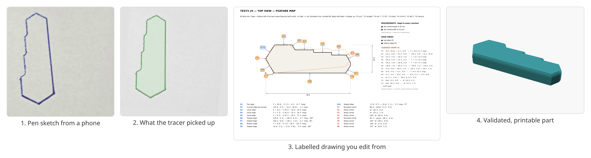

*Real output from a real Discord session. The demo below comes from the bot's channel history, and it says so wherever an example comes from somewhere else.*

Protoman is for people who own a 3D printer and need a simple flat part now: a shim, bracket, spacer, cover plate or replacement tab. Draw the shape, give it a length, width and thickness, and print the result. If it needs changing, you tap an edge on the drawing and enter a number. You never have to open a CAD program, and the whole flow works on a phone.

Protoman is one of three bots in the [Discord Bot Network](../README.md), but it runs fine on its own.

You run your own copy of the bot, with your own Discord application, on any Linux machine or in Docker.

| | |
|---|---|
| **Input** | A photo of a drawing, or of a real object lying on a sheet of paper |
| **Output** | Binary STL, parametric `.scad`, labelled drawing (PNG and PDF), 3D preview |
| **Editing** | Dropdowns, buttons and pre-filled number pop-ups, or typed edits such as `E3 up 2, C2 R5` |
| **Parts it can make** | One traced outline, extruded flat, with holes, slots, screw recesses, nut pockets and rounded or chamfered edges |
| **Parts it can't make** | Anything whose thickness varies, such as pockets, bosses, raised text or multi-part assemblies |

**Contents:** [Demo](#demo-real-sessions) · [Gallery](#gallery-of-real-models) · [Install](#install) · [Commands](#using-the-bot) · [Design](#design-overview) · [Limitations](#known-issues-and-limitations) · [Questions for reviewers](#questions-for-design-reviewers)

> **Reviewing this design, human or AI?** This README is written to stand alone. Every image in the demo has its message text beside it, so you can follow without seeing images. Start at [Design overview](#design-overview) and finish at [Questions for design reviewers](#questions-for-design-reviewers). The [evidence table](#what-has-and-hasnt-been-verified) separates what has been verified from what has not.

---

## Demo: real sessions

All of this happened in the bot's Discord channel between 27 and 29 October 2026.

> **How these images were made.** They are not screen captures of the Discord app. The `chat-*` images were rendered from the channel's message data, fetched from the Discord API, using the real text, attachments, buttons and timestamps. The `ui-*` images show private panels and pop-ups, which never appear in channel history, so they were generated by running this repo's `cards.py` on real parts. The user's handle is replaced with `maker`, the user's avatar is a placeholder, and the styling only approximates Discord's. The bot's avatar is the real one (`docs/images/protoman-avatar.png`). The message text under each image is copied word for word from the API response, with only Discord's bold and code marks removed.

### 1. The first sketch, and what went wrong

The very first photo was a capsule with a hole, drawn in pen, with a hard shadow across half the page.

`/sketch` · length `92` · width `24` · thickness `12` · symmetry `Top ↔ bottom` · straighten `on` · style `Outline only`

| The photo that was sent | What the tracer saw then | Same photo, tracer fixed |
|---|---|---|
| 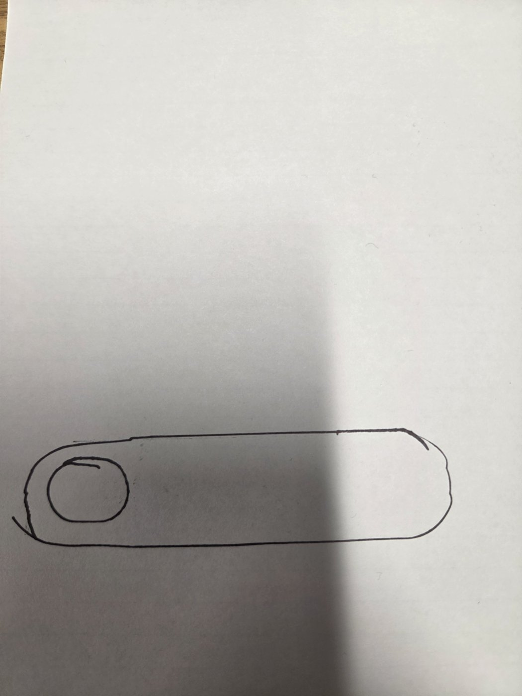 | 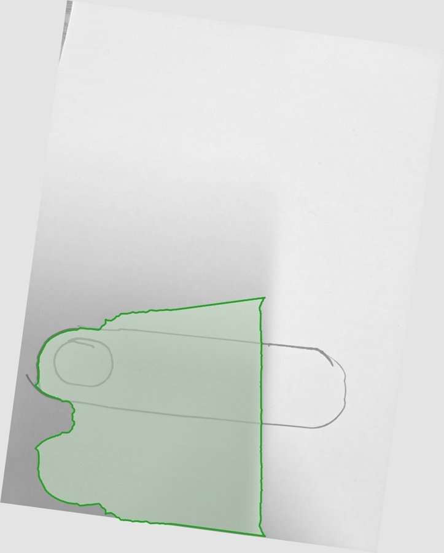 | 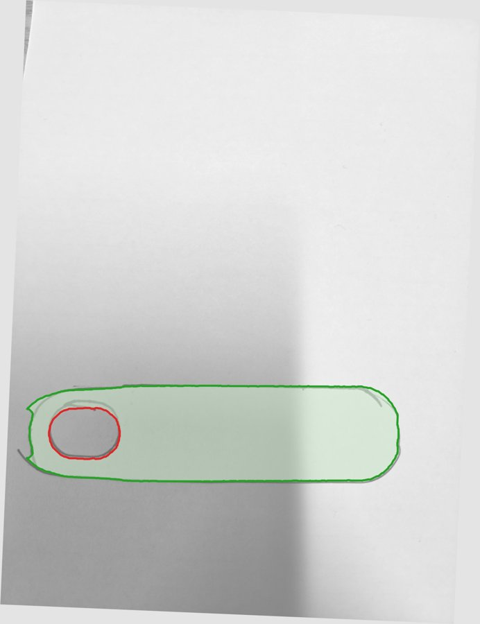 |

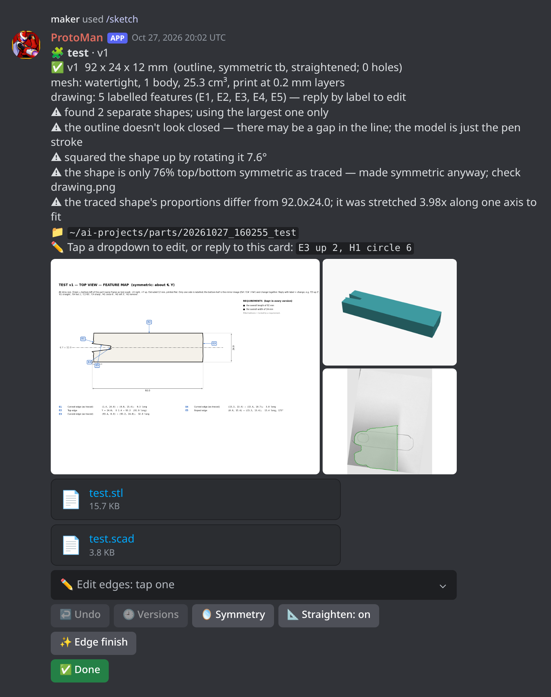

<details><summary>Message text</summary>

```text
🧩 test · v1
✅ v1  92 x 24 x 12 mm  (outline, symmetric tb, straightened; 0 holes)
mesh: watertight, 1 body, 25.3 cm³, print at 0.2 mm layers
drawing: 5 labelled features (E1, E2, E3, E4, E5) — reply by label to edit
⚠ found 2 separate shapes; using the largest one only
⚠ the outline doesn't look closed — there may be a gap in the line; the model is just the pen stroke
⚠ squared the shape up by rotating it 7.6°
⚠ the shape is only 76% top/bottom symmetric as traced — made symmetric anyway; check drawing.png
⚠ the traced shape's proportions differ from 92.0x24.0; it was stretched 3.98x along one axis to fit
📁 ~/ai-projects/parts/20261027_160255_test
✏️ Tap a dropdown to edit, or reply to this card: E3 up 2, H1 circle 6
```

</details>

The tracer took the shadow for ink, and the part came out as a trapezoid. The warnings gave it away: a shape stretched 3.98× is plainly wrong. Shaded paper was darker than lit ink, which defeated a single global threshold. The tracer now estimates paper brightness locally, and replaying the same photo gives the capsule and its hole, with the stretch warning gone:

```text
✅ v1  92 x 24 x 12 mm  (outline, symmetric tb, straightened; 1 hole)
mesh: watertight, 1 body, 22.8 cm³, print at 0.2 mm layers
drawing: 4 labelled features (E1, E2, C1, H1) — reply by label to edit
⚠ there's a shadow or dark patch on the page — traced the pen lines through it; even light works best
⚠ bridged a gap in the outline (~23 px) — draw the line all the way round to be sure
⚠ found 2 separate shapes; using the largest one only
⚠ squared the shape up by rotating it 2.5°
⚠ the shape is only 91% top/bottom symmetric as traced — made symmetric anyway; check drawing.png
```

| Before the fix | After the fix |
|---|---|
| 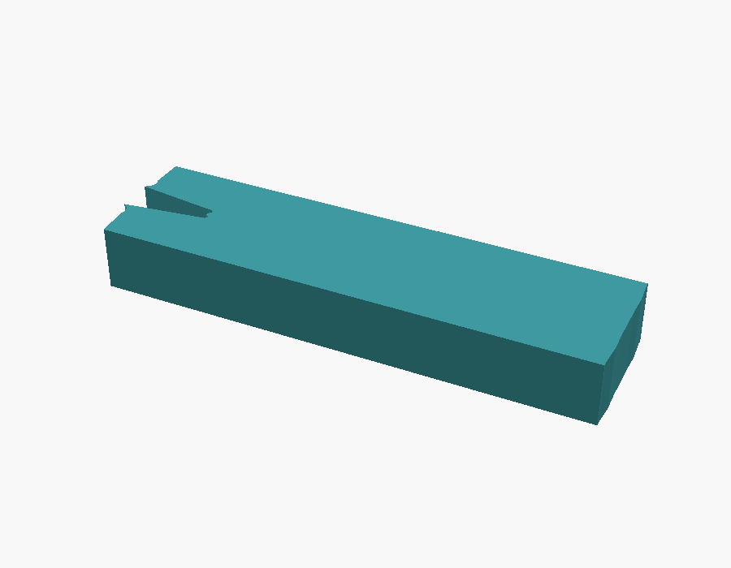 | 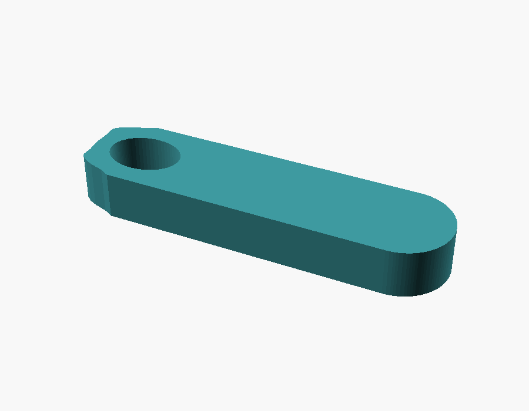 |

### 2. Refining a part by tapping

A hand-drawn profile with three steps, sized 30 × 10 × 4 mm.

`/sketch` · length `30` · width `10` · thickness `4` · straighten `on` · style `Outline only`

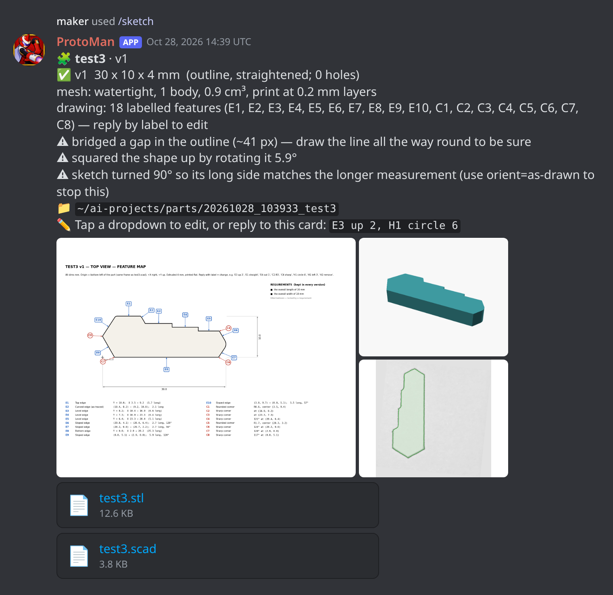

<details><summary>Message text</summary>

```text
🧩 test3 · v1
✅ v1  30 x 10 x 4 mm  (outline, straightened; 0 holes)
mesh: watertight, 1 body, 0.9 cm³, print at 0.2 mm layers
drawing: 18 labelled features (E1, E2, E3, E4, E5, E6, E7, E8, E9, E10, C1, C2, C3, C4, C5, C6, C7, C8) — reply by label to edit
⚠ bridged a gap in the outline (~41 px) — draw the line all the way round to be sure
⚠ squared the shape up by rotating it 5.9°
⚠ sketch turned 90° so its long side matches the longer measurement (use orient=as-drawn to stop this)
📁 ~/ai-projects/parts/20261028_103933_test3
✏️ Tap a dropdown to edit, or reply to this card: E3 up 2, H1 circle 6
```

</details>

Tapping **✨ Edge finish** and choosing *all edges, rounded, 1 mm* gave v2. The engine's note for this version is `all edges R1.0`, and it added a printing warning that wasn't there before:

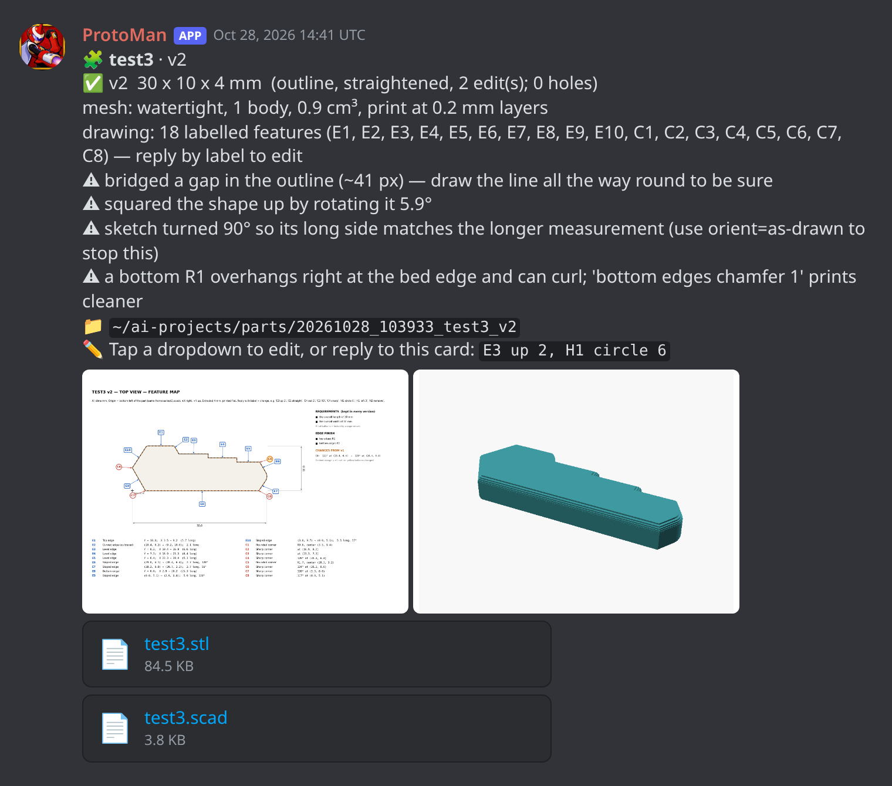

<details><summary>Message text</summary>

```text
🧩 test3 · v2
✅ v2  30 x 10 x 4 mm  (outline, straightened, 2 edit(s); 0 holes)
mesh: watertight, 1 body, 0.9 cm³, print at 0.2 mm layers
drawing: 18 labelled features (E1, E2, E3, E4, E5, E6, E7, E8, E9, E10, C1, C2, C3, C4, C5, C6, C7, C8) — reply by label to edit
⚠ bridged a gap in the outline (~41 px) — draw the line all the way round to be sure
⚠ squared the shape up by rotating it 5.9°
⚠ sketch turned 90° so its long side matches the longer measurement (use orient=as-drawn to stop this)
⚠ a bottom R1 overhangs right at the bed edge and can curl; 'bottom edges chamfer 1' prints cleaner
📁 ~/ai-projects/parts/20261028_103933_test3_v2
✏️ Tap a dropdown to edit, or reply to this card: E3 up 2, H1 circle 6
```

</details>

Straighten was then turned off (v3 and v4) and back on through the card. Meanwhile `/part` brought the part back after other work, with its buttons. This pair of messages is from that step:

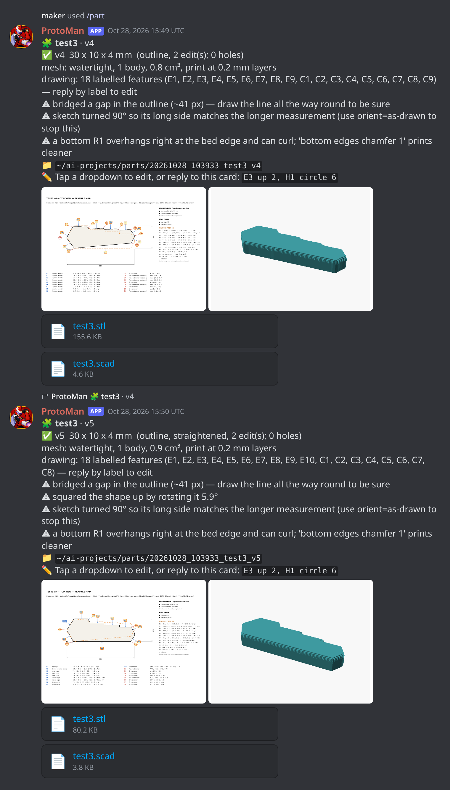

<details><summary>Message text</summary>

```text
🧩 test3 · v4
✅ v4  30 x 10 x 4 mm  (outline, 2 edit(s); 0 holes)
mesh: watertight, 1 body, 0.8 cm³, print at 0.2 mm layers
drawing: 18 labelled features (E1, E2, E3, E4, E5, E6, E7, E8, E9, C1, C2, C3, C4, C5, C6, C7, C8, C9) — reply by label to edit
⚠ bridged a gap in the outline (~41 px) — draw the line all the way round to be sure
⚠ sketch turned 90° so its long side matches the longer measurement (use orient=as-drawn to stop this)
⚠ a bottom R1 overhangs right at the bed edge and can curl; 'bottom edges chamfer 1' prints cleaner
📁 ~/ai-projects/parts/20261028_103933_test3_v4
✏️ Tap a dropdown to edit, or reply to this card: E3 up 2, H1 circle 6
```

</details>

<details><summary>Message text</summary>

```text
🧩 test3 · v5
✅ v5  30 x 10 x 4 mm  (outline, straightened, 2 edit(s); 0 holes)
mesh: watertight, 1 body, 0.9 cm³, print at 0.2 mm layers
drawing: 18 labelled features (E1, E2, E3, E4, E5, E6, E7, E8, E9, E10, C1, C2, C3, C4, C5, C6, C7, C8) — reply by label to edit
⚠ bridged a gap in the outline (~41 px) — draw the line all the way round to be sure
⚠ squared the shape up by rotating it 5.9°
⚠ sketch turned 90° so its long side matches the longer measurement (use orient=as-drawn to stop this)
⚠ a bottom R1 overhangs right at the bed edge and can curl; 'bottom edges chamfer 1' prints cleaner
📁 ~/ai-projects/parts/20261028_103933_test3_v5
✏️ Tap a dropdown to edit, or reply to this card: E3 up 2, H1 circle 6
```

</details>

v5's drawing is the part's working document. Orange dashes show the v4 outline, and the panel on the right lists what changed:

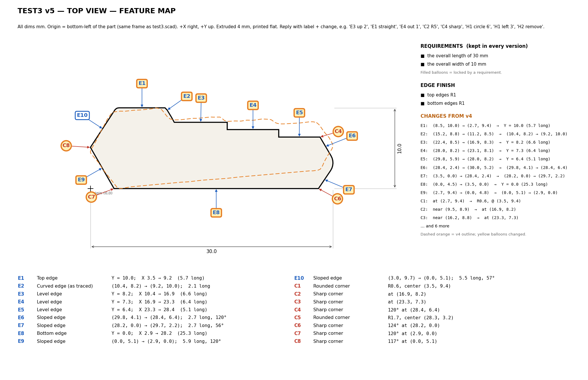

An excerpt of the table, which also gives the exact geometry of each label:

```text
E1   Top edge                  Y = 10.0;  X 3.5 → 9.2  (5.7 long)
E2   Curved edge (as traced)   (10.4, 8.2) → (9.2, 10.0);  2.1 long
E3   Level edge                Y = 8.2;  X 10.4 → 16.9  (6.6 long)
C1   Rounded corner            R0.6, center (3.5, 9.4)
C4   Sharp corner              120° at (28.4, 6.4)
```

v3 and v4 being twins was itself a bug: a second tap, queued during a build, acted on a stale version. See [real bugs](#real-bugs-found-in-use).

### 3. Adding holes and screws

A drawn circle, 40 × 40 × 20 mm, mirrored both ways.

`/sketch` · length `40` · width `40` · thickness `20` · symmetry `Both` · straighten `on` · style `Outline only`

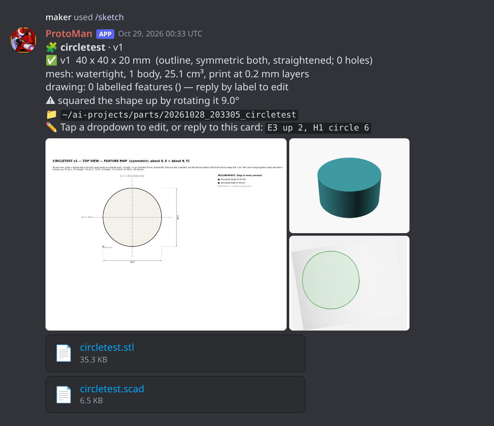

<details><summary>Message text</summary>

```text
🧩 circletest · v1
✅ v1  40 x 40 x 20 mm  (outline, symmetric both, straightened; 0 holes)
mesh: watertight, 1 body, 25.1 cm³, print at 0.2 mm layers
drawing: 0 labelled features () — reply by label to edit
⚠ squared the shape up by rotating it 9.0°
📁 ~/ai-projects/parts/20261028_203305_circletest
✏️ Tap a dropdown to edit, or reply to this card: E3 up 2, H1 circle 6
```

</details>

**➕ Add hole → Slot** opened a pop-up with width, length, angle and position. The edit it produced was `add slot 5 15 angle 0 at 20, 20`:

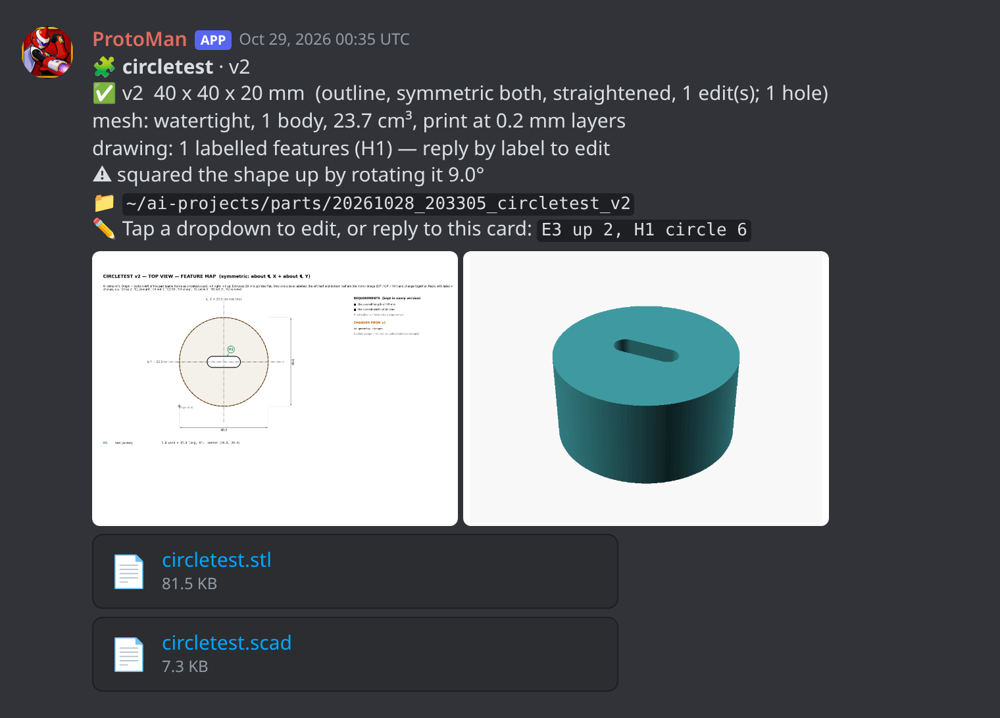

<details><summary>Message text</summary>

```text
🧩 circletest · v2
✅ v2  40 x 40 x 20 mm  (outline, symmetric both, straightened, 1 edit(s); 1 hole)
mesh: watertight, 1 body, 23.7 cm³, print at 0.2 mm layers
drawing: 1 labelled features (H1) — reply by label to edit
⚠ squared the shape up by rotating it 9.0°
📁 ~/ai-projects/parts/20261028_203305_circletest_v2
✏️ Tap a dropdown to edit, or reply to this card: E3 up 2, H1 circle 6
```

</details>

**➕ Add hole → M4 → screw head → top face** then produced `add M4 screw top at 18.8, 8.8`, and exposed a real bug. The pre-filled position was 1.2 mm from the mirror line, so the hole and its mirror image overlapped into a peanut. All the mesh checks still passed. A human looking at the drawing caught it.

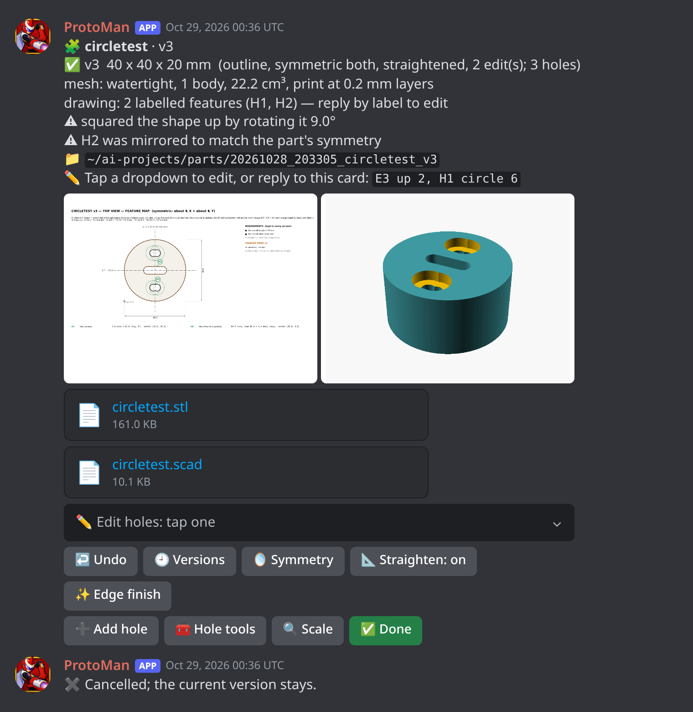

<details><summary>Message text</summary>

```text
🧩 circletest · v3
✅ v3  40 x 40 x 20 mm  (outline, symmetric both, straightened, 2 edit(s); 3 holes)
mesh: watertight, 1 body, 22.2 cm³, print at 0.2 mm layers
drawing: 2 labelled features (H1, H2) — reply by label to edit
⚠ squared the shape up by rotating it 9.0°
⚠ H2 was mirrored to match the part's symmetry
📁 ~/ai-projects/parts/20261028_203305_circletest_v3
✏️ Tap a dropdown to edit, or reply to this card: E3 up 2, H1 circle 6
```

</details>

<details><summary>Message text</summary>

```text
✖️ Cancelled; the current version stays.
```

</details>

| Real v3, with the bug | Same inputs on the fixed engine | Underside, showing the version stamp |
|---|---|---|
| 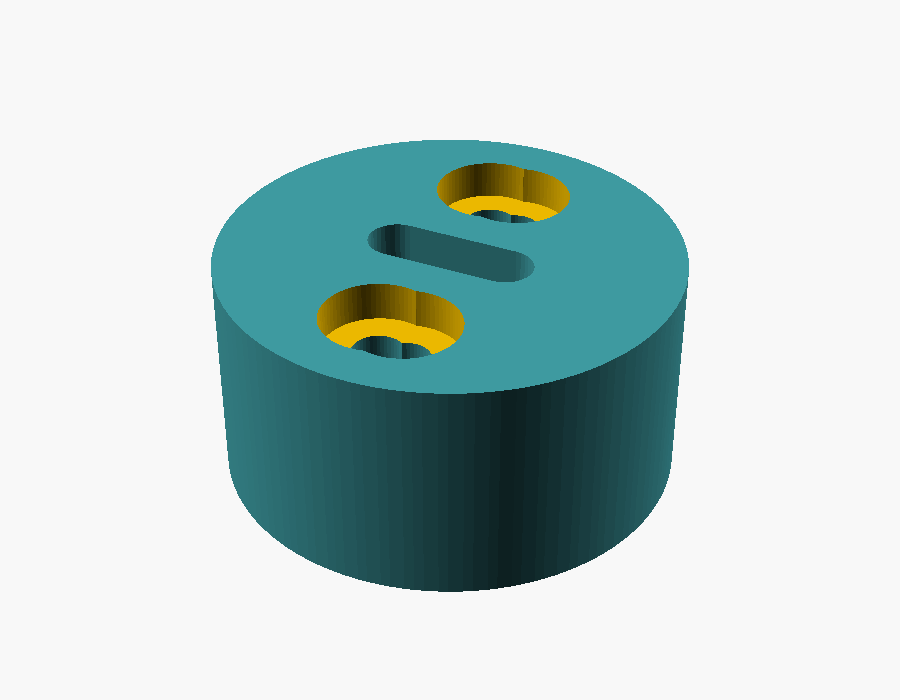 | 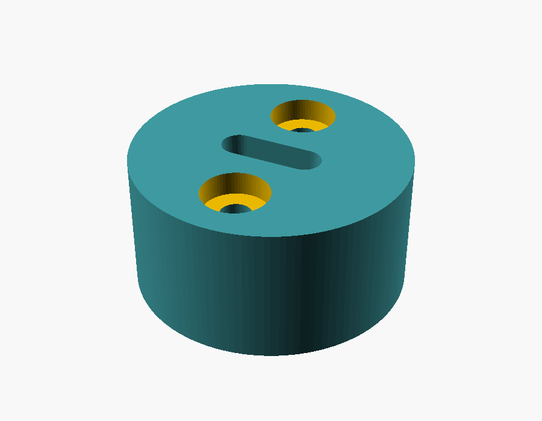 | 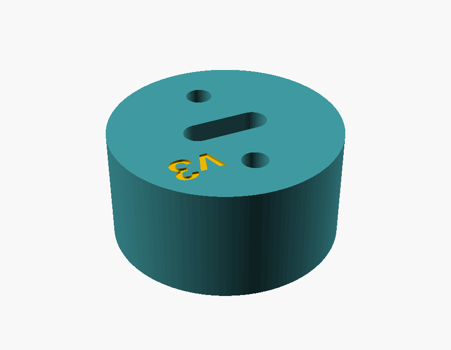 |

A hole that would hit its own mirror image now moves onto the line and says so. The hole check also rejects overlapping copies:

```text
✅ v3  40 x 40 x 20 mm  (outline, symmetric both, straightened, 2 edit(s); 3 holes)
⚠ H2 put on the vertical centreline (X = 20.0): 1.2 mm off it, it would have overlapped its own mirror image
⚠ H2 was mirrored to match the part's symmetry
```

### 4. The controls

These are the views a user sees on a phone, all generated by `cards.py`.

| Card controls | Tap an edge | The private panel |
|---|---|---|
| 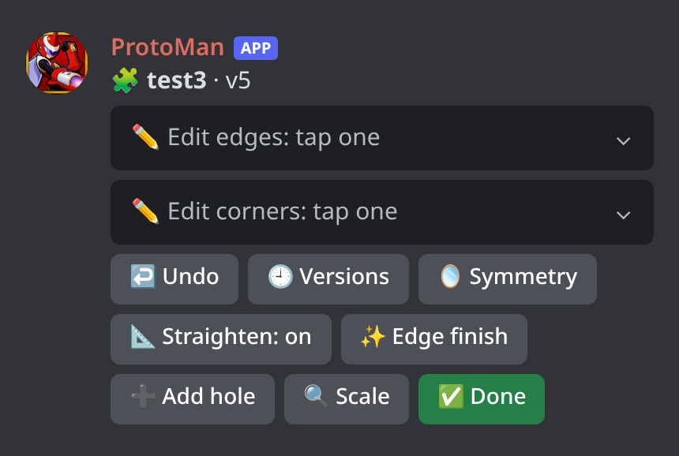 | 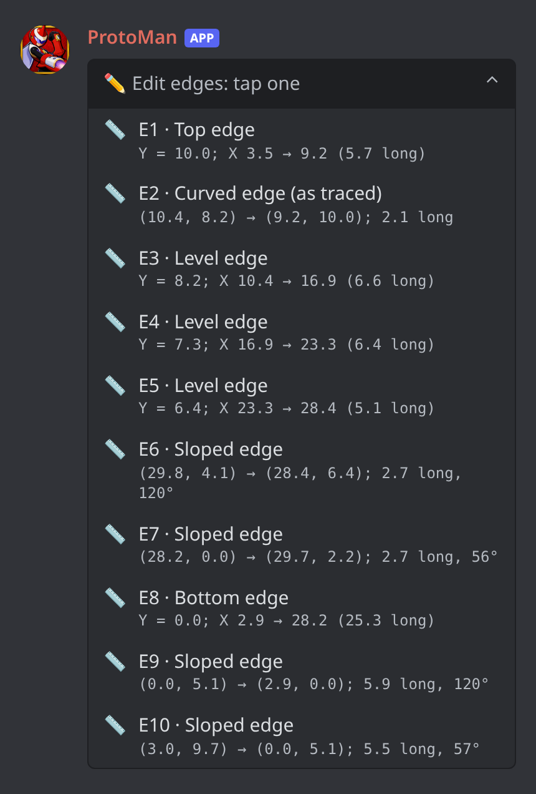 | 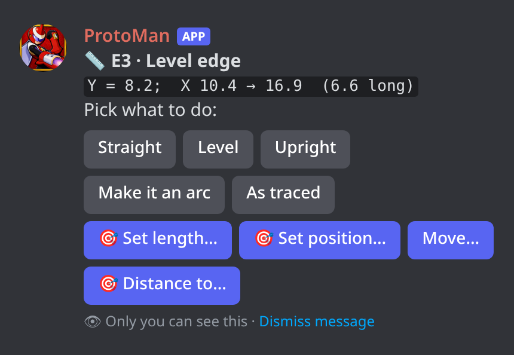 |

| Pre-filled number | Choices first | Then the numbers |
|---|---|---|
| 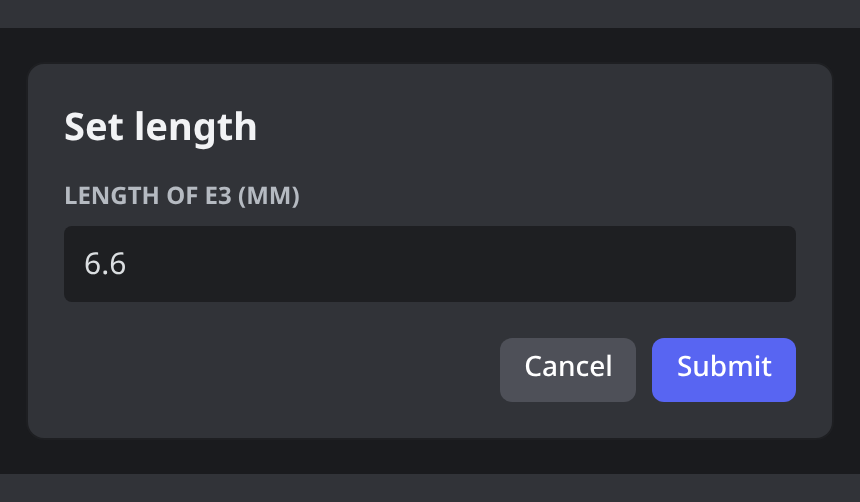 | 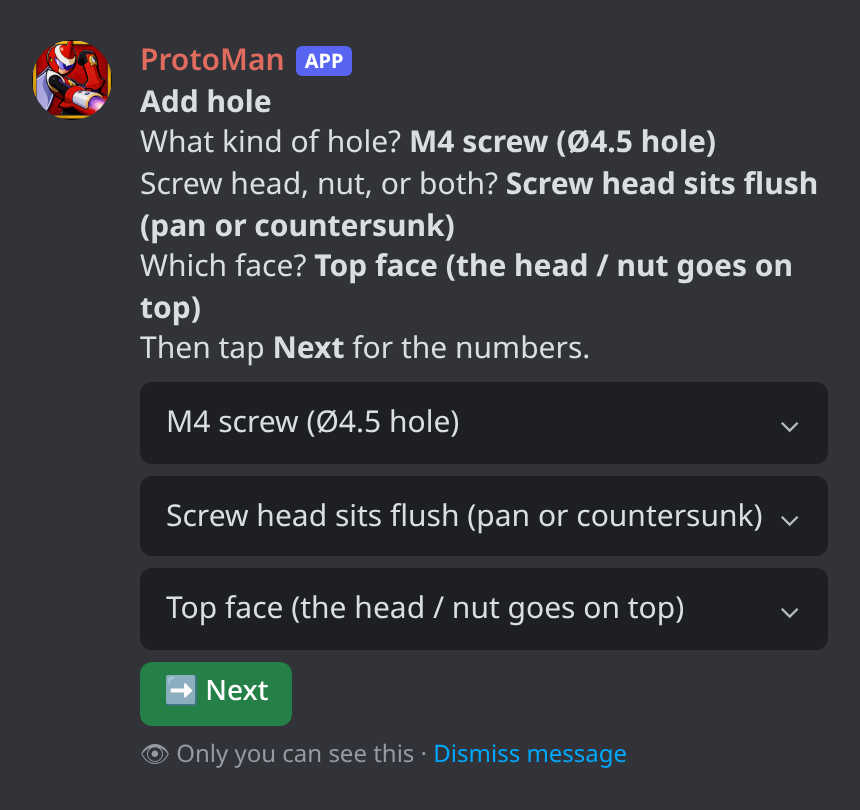 | 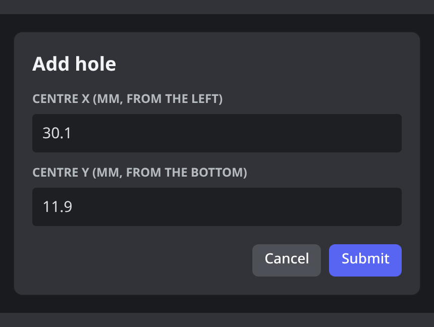 |

| A hole's actions | Going back | When requirements clash |
|---|---|---|
| 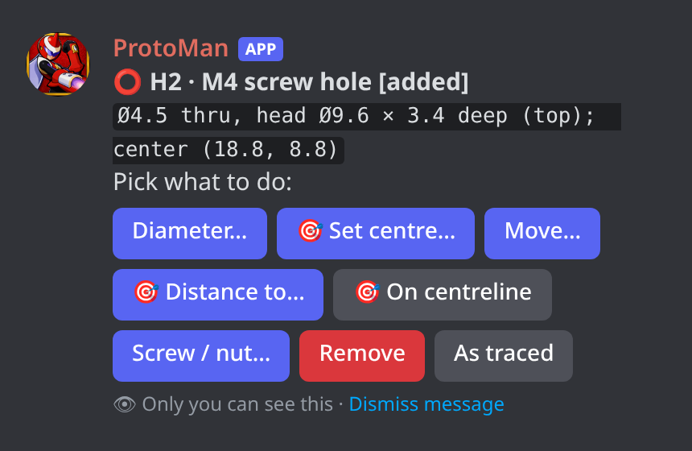 | 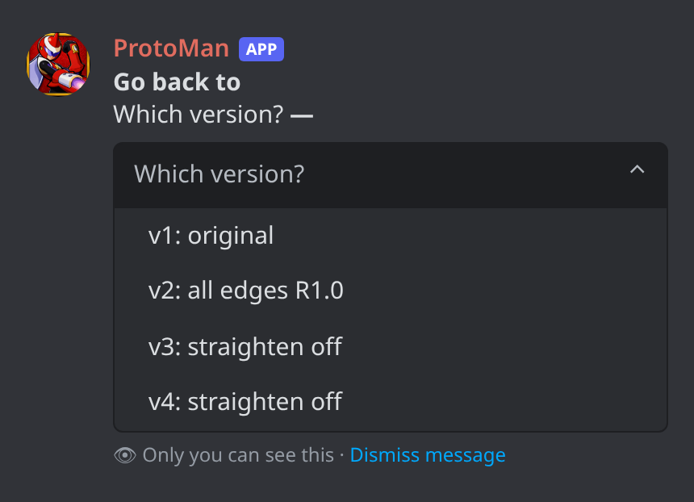 | 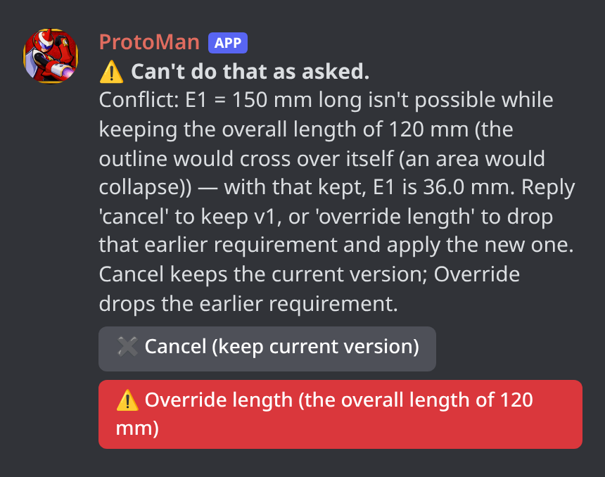 |

Text of the conflict in the last image, from the bracket test fixture:

```text
⚠️ Can't do that as asked.
Conflict: E1 = 150 mm long isn't possible while keeping the overall length of 120 mm (the outline would cross over itself (an area would collapse)) — with that kept, E1 is 36.0 mm. Reply 'cancel' to keep v1, or 'override length' to drop that earlier requirement and apply the new one.
Cancel keeps the current version; Override drops the earlier requirement.
[✖️ Cancel (keep current version)]  [⚠️ Override length (the overall length of 120 mm)]
```

## Gallery of real models

Every part from the channel, plus the replays from the demo. OpenSCAD rendered the previews from each part's own `.scad`.

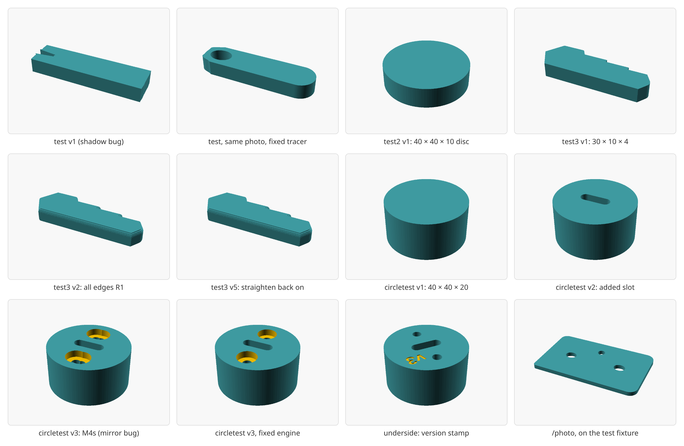

Download any of them from [`examples/`](examples/):

| Folder | What it is | Size (mm) |
|---|---|---|
| `test_v1` | First sketch, real card, shows the shadow bug | 92 × 24 × 12 |
| `test_rebuilt` | Same photo through the current engine | 92 × 24 × 12 |
| `test2_v1` | Drawn circle, mirrored left-right | 40 × 40 × 10 |
| `test3_v1`, `test3_v2`, `test3_v5` | Stepped profile: original, rounded edges, straighten back on | 30 × 10 × 4 |
| `circletest_v1`, `_v2`, `_v3` | Circle: original, slot, M4 screws with the mirror bug | 40 × 40 × 20 |
| `circletest_v3_rebuilt` | Same inputs and edits through the current engine | 40 × 40 × 20 |
| `photo_fixture_plate` | `/photo` on the repo's synthetic test image; **not** from the channel | 100.4 × 60.1 × 4 |

The STL and `.scad` files in the `_vN` folders are the same ones the bot attached in Discord. The only change is one comment line in each `.scad` that named a script not in this repo. Photos were re-encoded to drop metadata. **None of these parts is claimed to have been printed;** they demonstrate the software.

---

## Install

You need a Discord server where you can add bots, and a machine to run the bot on. Each copy serves **one channel**.

### Step 1: Create the Discord bot

1. Go to the [Discord Developer Portal](https://discord.com/developers/applications) and click **New Application**. Name it whatever you like.
2. On the **Bot** tab, click **Reset Token** and copy the token. Treat it like a password.
3. On the same tab, enable **Message Content Intent**. The bot reads replies to its cards as edits.
4. In Discord, create a channel for the bot, such as `#prototypes`. Turn on Developer Mode (*User Settings → Advanced*), right-click the channel and choose **Copy Channel ID**.

Anyone who can see that channel can use the bot and edit its parts, so choose its members accordingly. See [Security model](#security-model).

### Step 2: Run it

**Option A: Docker (recommended).** This includes OpenSCAD and every other dependency.

```bash
git clone <your-fork-url> protobot && cd protobot
cp .env.example .env        # paste your token and channel ID into .env
mkdir -p data               # parts, log and state are stored here
docker compose run --rm protoman python3 protoman.py --check
docker compose run --rm protoman python3 protoman.py --invite   # open this link to add the bot
docker compose up -d
```

The container runs as user ID 1000. If your own ID differs (check with `id -u`), run `sudo chown 1000 data`. The image is about 1.7 GB.

**Option B: Python on Linux (x86_64).**

```bash
git clone <your-fork-url> protobot && cd protobot
python3 -m venv .venv && . .venv/bin/activate
pip install -r requirements.txt

# System packages. Debian/Ubuntu (the same list the Docker image uses):
sudo apt install admesh xvfb xauth fontconfig fonts-dejavu-core libegl1 libgl1 \
    libgl1-mesa-dri libglib2.0-0 libglu1-mesa libharfbuzz0b libopengl0 libxcb-cursor0 libxkbcommon0
# Fedora: sudo dnf install admesh xorg-x11-server-Xvfb harfbuzz

scripts/install_openscad.sh     # into ~/.local; make sure ~/.local/bin is on your PATH
python3 protoman.py --setup     # asks for token and channel ID, prints the invite link
python3 protoman.py --check
python3 protoman.py
```

To keep it running as a service: `deploy/install_service.sh`, then watch it with `journalctl --user -u protoman -f`.

> **OpenSCAD version:** Protoman calls `openscad --backend=manifold`, which the 2021.01 release in most package repositories doesn't support. `--check` tests this directly. You can also point `PROTOBOT_OPENSCAD` at any suitable binary.

### Step 3: Confirm it works

Open the invite link and add the bot to your server. Make sure it can see your channel. On startup the log should say `Synced 4 slash commands`, and you can then run `/protohelp` in the channel.

`--check` should end in `Ready.`:

```text
✅ Python 3.12.16 (3.10+)
✅ engine: ready (engine snapshot 2026-10-28)
✅ OpenSCAD with the manifold backend
✅ admesh (extra mesh check)
✅ a display or xvfb-run (3D preview images)
✅ bot token configured
✅ channel ID configured

Ready.
```

### Configuration

Values come from `~/.protoman.json` (created by `--setup`, mode 600). Environment variables override the file.

| File key | Environment variable | Default | Meaning |
|---|---|---|---|
| `discord_token` | `DISCORD_TOKEN` | none | Bot token |
| `discord_channel_id` | `PROTOMAN_CHANNEL_ID` | none | The one channel the bot works in |
| `parts_root` | `PROTOMAN_PARTS_DIR` | `~/protoman-parts` | Where part folders go |
| `log_file` | `PROTOMAN_LOG_FILE` | `~/.protoman.log` | Rotating log |
| `engine_dir` | none | `./engine` | The engine folder |
| none | `PROTOMAN_CONFIG` | `~/.protoman.json` | Path of the config file |
| none | `PROTOBOT_OPENSCAD` | `openscad` | OpenSCAD binary |

### Run the tests

```bash
python3 -m pytest -q
```

There are 31 tests, taking about a minute. 11 of them run real builds and are skipped if OpenSCAD is missing.

---

## Using the bot

### Commands

| Command | Required | Optional |
|---|---|---|
| `/sketch` | `image`, `length`, `width`, `thickness` | `symmetry`, `straighten`, `style` (auto / filled / outline), `name` |
| `/photo` | `image`, `thickness` | `length` + `width` (both or neither), `paper` (Letter / A4 / none), `symmetry`, `straighten`, `name` |
| `/part` | `part` (autocomplete, newest first) | |
| `/protohelp` | | |

**For a good `/sketch`:** dark pen on plain paper, one shape, a fully closed line, even light. The sketch sets the shape and your numbers set the size. If the proportions disagree, the shape is stretched to fit and the card warns you.

**For a good `/photo`:** lay the object on a sheet of paper and shoot from straight above with all four corners in frame. The bot measures size from the paper (±1–2 mm; hole sizes ±1 mm), or you can supply exact dimensions.

### Reading a card

Each version posts one card: the drawing, the 3D preview, the trace (first version only), the `.stl` and the `.scad`. ✅ means the mesh passed its checks, and each ⚠ line is worth reading. On the drawing, **E** marks edges, **C** corners and **H** holes.

Only the newest card keeps its buttons, and buttons always act on the newest version.

### Card controls

| Control | What it does |
|---|---|
| **Edit edges / corners / holes** | Pick a feature, then choose an action from a private panel |
| 🎯 actions | Set a *requirement*, such as "E3 is exactly 20 mm", that later edits must keep. 🔒 marks a locked feature |
| ↩️ **Undo** / 🕘 **Versions** | Go back. This builds a *new* version, so nothing is lost |
| 🪞 **Symmetry** | None, left-right, top-bottom or both |
| 📐 **Straighten** | True straight lines and round holes, on or off |
| ✨ **Edge finish** | Round or chamfer the top and/or bottom edges |
| ➕ **Add hole** | Plain round hole, slot, or M2–M8 with head recess and/or nut pocket |
| 🧰 **Hole tools** | Same size, spacing, even spacing (needs 2–3+ holes) |
| 🔍 **Scale** | Set length, width or percent. Thickness and true sizes such as M3 stay the same |
| ✅ **Done** | Remove the buttons. `/part` brings them back |

### Typed edits (optional)

Reply to a card, or send a message starting with a label or `top`, `bottom`, `all` or `undo`, which goes to your last part. Clauses are separated by commas.

| Kind | Examples |
|---|---|
| Edges | `E3 straight`, `E1 level`, `E2 plumb`, `E4 arc`, `E3 up 2`, `E4 out 1`, `E5 raw` |
| Corners | `C2 R5`, `C4 sharp`, `C3 chamfer` |
| Holes | `H1 circle 6`, `H1 left 3`, `H2 remove` |
| Requirements | `E3 is 20mm`, `E3 at 30`, `H1 at 20, 30`, `H1 to E3 is 10`, `H1 H2 apart 40`, `H1 H2 H3 evenly spaced`, `H1 on centreline`, `H1 H2 same size` |
| Whole part | `all edges R1`, `top edges chamfer 0.5`, `bottom edges sharp`, `scale to 120 long`, `scale 150%`, `undo` |
| Adding | `add hole 5 at 20, 10`, `add M3 at 20, 10`, `add M4 nut bottom at 30 12`, `add M3 screw+nut at 15, 8`, `add slot 6 20 angle 90 at 30, 10` |
| Fasteners | `H1 M3`, `H2 M4 nut bottom`, `H1 plain`, `H3 slot 6 25 angle 45` |

---

## Design overview

### Goals

1. **A phone is enough.** Only numbers are ever typed, and they come pre-filled. Every other choice is a dropdown or button.
2. **Never silently wrong.** Each build passes a mesh check, and every guess the software makes (rotation, stretch, bridged gaps) is reported as a warning.
3. **Nothing is lost.** Every change is a new version folder. Undo also builds forward.
4. **Numbers mean what they say.** If you type a 6 mm hole, it comes out 6 mm, whatever scaling happened around it.
5. **The output is the user's.** The `.scad` is readable and parametric, so a part can leave this tool.

**Non-goals:** general CAD, parts that vary in thickness, multi-tenant hosting.

### Architecture

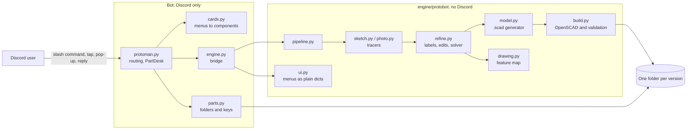

| Module | Lines | Responsibility |
|---|---|---|
| `protoman.py` | 900 | Config, slash commands, `PartDesk` (one build at a time, cards, conflicts, forms), interaction routing, `--setup` / `--check` / `--invite` |
| `cards.py` | 260 | Turns engine menus into Discord components. Holds no callbacks |
| `parts.py` | 110 | Folder names, family keys, latest version, per-user last part |
| `engine.py` | 115 | The only module that imports the engine |
| `engine/protobot/pipeline.py` | 505 | `sketch_to_part`, `photo_to_part`, `revise_part`, `undo_part`, `revert_part` |
| `engine/protobot/refine.py` | 2,105 | Square-up, symmetry, feature labelling, edit grammar, requirement solver, conflict explanation |
| `engine/protobot/ui.py` | 350 | Describes every action as JSON-able data: ready to run, or needing fields |
| `engine/protobot/sketch.py`, `photo.py` | 280, 265 | Two independent tracers |
| `engine/protobot/model.py` | 395 | Sizing, thin-feature check, version stamp, `.scad` text |
| `engine/protobot/drawing.py` | 300 | Ballooned feature map |
| `engine/protobot/fasteners.py` | 95 | ISO M2–M8 table and clearances |
| `engine/protobot/build.py` | 60 | Runs OpenSCAD and validates the mesh |

The main boundary: **the engine knows nothing about Discord, and the bot knows nothing about geometry.** The engine publishes its menus as plain data, and `cards.py` maps each field type to a component. A new engine action generally needs no bot code, unless it wants its own card button. The engine also has its own CLI (`cd engine && python3 -m protobot --help`).

### How a request flows

```text
/sketch or /photo (image and numbers are slash options, validated by Discord)
  → check_upload → parts.new_job_dir
  → engine.build_* in a worker thread, under PartDesk.lock
  → card: drawing, preview, trace (v1), .stl, .scad, components

tap a dropdown → private panel with that feature's actions
   ready action           → build the next version
   numbers only           → pop-up pre-filled with current values → build
   choices (and numbers)  → private dropdown form → Next → pop-up → build
   a single choice        → runs as soon as it's picked

conflict (two requirements clash) → public message: Cancel / Override…
reply to a card, or type "E3 up 2" → engine.revise
```

### State

**Parts live on disk; almost nothing lives in memory.** That is why cards survive restarts.

| State | Where | After a restart |
|---|---|---|
| Part versions | `parts_root/<YYYYmmdd_HHMMSS>_<name>[_vN]/` | Kept |
| Which part each user last touched | `~/.cache/protoman/last_part.json` | Kept |
| Half-filled forms | `PartDesk.forms`, by (user, part, action) | Lost; the user taps again |
| Pending conflicts | `PartDesk.pending`, by part | Lost, with a clear "expired" message |
| Last card, for removing its buttons | `PartDesk.cards` | Lost; old buttons still work and act on the newest version |

A version folder holds `input.*`, `job.json` (the recipe: parameters, edits, parent, note), `result.json` (the outcome), `outline.json`, `<name>.scad`, `<name>.stl`, `drawing.png`, `drawing.pdf`, `preview.png` and `trace.png`.

**A version is a recipe, not a patch.** Every revision re-runs the whole pipeline from the original image with the accumulated edit list. Geometry is never mutated in place. This keeps versions simple and reproducible for a given engine, but ties them to engine behaviour; see [question 1](#questions-for-design-reviewers).

### The button protocol

Components carry all their context in `custom_id`, so no in-memory view registry is needed. Views are `stop()`ped before sending, and `on_interaction` routes everything.

```text
pm|<verb>|<family key>|<args...>          max 100 characters (Discord's limit)
pm|a|20261028_203305_circletest|H2:screw
```

| Verb | Meaning | Args |
|---|---|---|
| `f` | A feature was picked from a card dropdown | kind, start index |
| `a` | An action button | action ID |
| `t` | Open the Hole tools panel | |
| `c` | A dropdown in a form | action ID, field |
| `n` | Next / Apply | action ID |
| `m` | A number pop-up was submitted | action ID |
| `o` | Conflict choice | index |
| `d` | Done | |

Buttons carry the **family** key, never a version, so an old button acts on the newest version instead of forking history.

### Concurrency

- One global `asyncio.Lock`: **one build at a time**, across all users and parts. Builds run in a worker thread, so the gateway stays responsive. A queued request shows "Waiting for the build ahead of this one…".
- The target version is read **inside** the lock, not at tap time, so a queued tap acts on the result of the build ahead of it. Toggle actions are re-read too, since they carry their state.
- Cards after a tap go out as interaction follow-ups, falling back to `channel.send` if the 15-minute token has expired.

### The engine pipeline

**1. Trace to a polygon, one of two separate tracers.** Keeping them apart means tuning one can't regress the other.

- *Sketch:* images are loaded upright (EXIF applied) at 1600 px on the long side. Paper brightness is estimated locally, so pen lines survive across shadow edges. Auto mode picks *filled* or *outline* by ink ratio. Outlines fill by the even-odd rule and erode by half the pen width, so the edge sits on the line's centre. Gaps are bridged by growing morphological closings, with a warning.
- *Photo:* finds the paper's four corners, warps to a top-down view and measures mm per pixel from the known sheet size. It separates object from paper by colour distance and Otsu thresholding. A region counts as a hole only if it is fenced off, clearly darker (×0.55) or lighter (×1.30) than the surface, and roughly convex.

**2. Refine** (`refine.py`), on the mask and then in real millimetres.

- Rotates up to 20° to square the part. Finds mirror lines and warns below 92% match.
- Splits the outline into labelled features: E, C, H. Mirror partners share one label, and only the kept half is labelled.
- Key tolerances: `SNAP_DEG` 5° (near level gets snapped), `BOW_MAX` 2% (more bow means a curve), `STEP_TURN` 30° (a smaller turn is a step, not a corner), `CIRCLE_RMS` 4% (below that, a round hole), `MIN_EDGE` 0.8 mm.

**3. Apply edits in two passes.** The first pass labels and assembles the unedited part, which fixes the frame where it is exactly length × width. The same labelled segments then move into that frame before edits apply, so typed numbers come out exact and labels stay put between versions.

**4. Solve requirements.** Absolute targets (`E3 is 20mm`, `H1 at 20, 30`, spacing, centreline) plus the overall size are hard constraints. Straight edges slide by the least total movement to meet them all. If that fails, `solve_or_explain` retries with each earlier requirement removed, then with pairs (up to 6 earlier requirements), and names what blocks the new one. No files are written on a conflict. The user can cancel or override, and if nothing earlier is to blame, no override is offered.

**5. Model.** Outlines are stored in a 0–1 unit box and scaled by `LENGTH` and `WIDTH` at the top of the `.scad`, so the file stays parametric. Features below 0.8 mm are warned about if they exceed 1% of the area. A 0.4 mm deep version stamp goes on the underside at the point deepest inside the shape. Edge finishes are built in 0.2 mm layer steps, as a printer would lay them down. Defaults assume a 0.4 mm nozzle, PLA and 0.2 mm layers.

**6. Export and validate.** OpenSCAD's manifold backend produces the binary STL, with a 300-second timeout. A part passes only if **all** of these hold:

- The STL is binary, watertight and one body.
- `admesh` reports no holes (when installed).
- Overall size is within 0.05 mm of the request.
- OpenSCAD reported no warnings.

A failing part still gets a card, marked ❌ with the reason, so the user can see and fix it.

### Fasteners

Sizes are nominal ISO maximums plus printing clearance.

| Size | Clearance hole Ø | Head recess Ø × depth | Nut pocket (across flats) × depth |
|---|---|---|---|
| M2 | 2.4 | 4.6 × 1.8 | 4.2 × 1.8 |
| M2.5 | 2.9 | 5.6 × 2.4 | 5.2 × 2.2 |
| M3 | 3.4 | 7.4 × 2.6 | 5.7 × 2.6 |
| M4 | 4.5 | 9.6 × 3.4 | 7.2 × 3.4 |
| M5 | 5.5 | 11.8 × 4.0 | 8.2 × 5.0 |
| M6 | 6.6 | 14.1 × 4.8 | 10.2 × 5.4 |
| M8 | 9.0 | 18.6 × 6.2 | 13.2 × 7.0 |

The recess is wide enough for a countersunk head and deep enough for a pan head, so either sits flush. Depths round up to whole 0.2 mm layers. At least 1.2 mm of plastic must remain under a recess, or the build stops and states the thickness needed.

### Decisions and their reasons

| Decision | Reason | Cost |
|---|---|---|
| Slash options carry the image and sizes | A part takes one round trip, and Discord validates the numbers (0.2–1000 mm) | Long commands on a phone |
| Stateless `custom_id` routing | Buttons survive restarts | Everything must fit in 100 characters |
| One card per version; old buttons removed | The channel shows one obvious place to act | Removal is in memory only, so old cards can stay live after a restart |
| Full rebuild per revision | No incremental geometry bugs; simple versioning | Each tap costs a full build; versions depend on the engine |
| Global build lock | A small machine can't be overwhelmed | Users queue behind each other |
| Two tracers | Tuning one can't break the other | Some duplicated image logic |
| Warnings instead of refusals | A flawed part with a clear warning beats no part | Users must read them |
| One channel per process | Simple permissions and sync | A second server needs a second copy |

### Discord limits the layout works within

5 component rows per message, 25 options per dropdown, 5 buttons per row, 100-character option text, 2000-character messages, and 45-character pop-up titles and labels. A pop-up holds at most 5 inputs. A test, `test_card_fits_discord_limits_with_many_features`, guards this.

### Security model

**Trust boundary: the channel.** Anyone who can see the channel can build and edit parts. There is no per-user ownership or role check, so **use a private channel if that matters to you.**

| Concern | Current handling |
|---|---|
| Bot token | From `~/.protoman.json` (mode 600) or the environment. `.env` and the config file are git-ignored. A test scans the repo for token patterns |
| Discord permissions | View Channel, Send Messages, Embed Links, Attach Files, Read Message History, Use Application Commands (`2147601408`). No admin rights |
| Scope | Commands and interactions outside the configured channel are refused |
| Uploads | Must be an image, under 25 MB. HEIC is refused with a hint. Decoding uses Pillow and OpenCV |
| File paths | Part keys must match `^\d{8}_\d{6}_[a-z0-9_]{1,24}$`, names are slugged, and the input's suffix comes from an allow-list |
| Code execution | The `.scad` is generated by the bot. User text reaches it only as a slug, and numbers as numbers |
| Container | Runs as a non-root user, with a 3 GB memory limit in the compose file |
| **Not handled** | Rate limits, per-user quotas and disk cleanup: parts grow without limit, and one user can hold the build queue. The 300-second timeout covers OpenSCAD only, not tracing |

Error messages may include part-folder paths. A public release of this repo removed a development-only `/debug` command that opened a coding-agent session on the host.

### Testing

| Suite | Count | Covers |
|---|---|---|
| `tests/test_scaffold.py` | 11 | Command surface, Discord-legal names, config, invite link, engine bridge |
| `tests/test_flow.py`, real builds | 11 | One part driven through `PartDesk` with fake Discord objects: every kind of control, conflict and override, typed edits, queued taps, screw holes, scale |
| `tests/test_flow.py`, pieces | 7 | Custom IDs, phone number formats (`12,5`, `12 mm`), modal parsing, folder naming, layout limits, upload checks |
| `tests/test_release.py` | 2 | No tokens, session links or home paths committed; secret files ignored |

The fake Discord objects verify the bot's logic, not Discord's rendering. The engine's own test suite, 59 tests at the time of this snapshot, lives in its development project and **isn't included here**, so geometry changes in this repo are covered only by the flow tests.

### Real bugs found in use

Offline tests missed all of these, which is why they are listed. Each came from real use.

| What the user saw | Cause | Fix |
|---|---|---|
| A capsule traced as a trapezoid | Shaded paper was darker than lit ink under a single brightness model | Local paper estimate; fill mode only when it really looks filled |
| An open outline traced as just the pen stroke | A ~20 px gap in the line | Grown closings bridge the gap, with a warning |
| Revision images stuck as blurred placeholders on a phone | Every affected card used `channel.send`; every working card was an interaction follow-up. Uploads and CDN were fine, so the cause is inferred | Cards now go out as follow-ups. Confirmed on the phone. Typed edits still use `channel.send` |
| Two taps gave twin versions (v3 and v4, both from v2) | The target version was read at tap time | Read inside the build lock |
| Straighten could only turn off | Bot passed `{}` and the engine read that as "off", not "toggle" | Bot passes `None` when no values were given |
| A slanted step came out square, with no label | A short step was misread as a rounded corner | Under a 30° turn, it stays an edge |
| Overlapping M4 "peanut" holes | A hole beside a mirror line overlapped its own image; shared labels skipped the check | Snap onto the line, deduplicate, check same-label overlap |

---

## What has and hasn't been verified

| Claim | Status |
|---|---|
| The bot worked live: `/sketch`, `/part`, tapped edits, pop-ups, a conflict with Cancel | ✅ Real channel history (19 messages, 27 Oct – 4 Nov 2026), on a private build of this code |
| **This packaged copy** connecting to real Discord | ❌ **Not yet run.** It differs from the live build: `/debug` removed, config and setup changes, small fixes. Offline tests pass and a fake token gives the correct login error. Expect the first live run to be its real test |
| `/photo` | ⚠️ Tested on synthetic fixtures only. It was never used in the real channel, and no real-photo results are shown |
| Fresh install, Python 3.14 venv, clean home directory | ✅ 31 tests passed |
| Docker image, Python 3.12, newest OpenSCAD snapshot (2026.11.01) | ✅ 30 passed, 1 skipped by design (needs a repo checkout); `--check` reports Ready; a real part built, with preview |
| `docker compose` with a bind-mounted data folder on an SELinux host | ✅ Bad-token run wrote its log to `./data` |
| Dimensional accuracy of a printed part | ❌ Not measured. Mesh size is checked to 0.05 mm; printed parts are not. Fastener clearances derive from standards, with one printed M4 nut fit |
| `deploy/install_service.sh` | ❌ Not run. The original unit it derives from has run for days |
| Debian/Ubuntu and Fedora package lists for Option B | ⚠️ Debian names were verified through the Docker image. Fedora names come from the development machine, which already had them |
| macOS, Windows, ARM | ❌ Not tested. The OpenSCAD installer is x86_64 Linux only |

## Known issues and limitations

**Bugs and rough edges**

- **Engine updates can renumber labels.** Replaying an old version on a newer engine can shift labels, and a stored edit could then hit a different feature. Example from this repo: `E8` in the real `test3` v5 is the 25.3 mm bottom edge, but replaying it on the current engine gives an `E8` of 2.7 mm. Nothing warns about this today.
- **The conflict text tells users to reply `cancel` or `override length`, but the bot doesn't handle those words.** The buttons work. The channel history contains a typed `cancel` that got no response, although its intent is unknown.
- **A perfect circle with `symmetry: both` has zero labels** (see `circletest` v1 in the demo), so no feature dropdowns appear. Only whole-part actions are available.
- **The hint on every card says `E3 up 2, H1 circle 6`,** even when the part has no E3 or H1.
- **Typed edits post cards with `channel.send`,** the path that showed blurred images on a phone.
- **An override's warning isn't saved to `result.json`,** so it's missing when `/part` re-opens the card.
- **Parts with more than 75 labels** show only the first 75 in dropdowns. Typed edits reach the rest.
- **Sketches default to rotating 90°** to match the longer measurement. The warning mentions `orient=as-drawn`, which is a CLI option with no Discord control.
- **Card folder paths** show paths on the host, which are meaningless to other users in the channel.

**Scope limits**

- Flat extrusions only.
- One channel per running copy, and one build at a time.
- No part deletion, rename or gallery from Discord.
- Print defaults assume 0.4 mm nozzle, PLA, 0.2 mm layers, and there's no setting for this yet.

**Possible next features:** pockets and recesses, raised lips, engraved text, vent patterns, bosses, splitting large parts for the bed, snap clips, mounting tabs, starting from an SVG or STL, teardrop holes, and a single house clearance setting.

## Questions for design reviewers

If you're reviewing this, these are the questions where outside judgement would help most. Please say what you'd change and why, and point out anything important this list misses.

1. **Replay versus snapshot.** Each version replays image + edits through the current engine. Should labels be stored as stable geometric references, should a version pin its engine, or should old versions be frozen as geometry? (See the `E8` example above.)
2. **Is label-based editing right?** Labels come from automatic segmentation of a noisy trace. `test3` produced 18 features for a simple shape. Is there a better unit of editing for a phone?
3. **Warnings versus refusal.** The first real sketch was visibly wrong and still got ✅, with the warnings beside it, because the ✅ only means the mesh is printable. Should a 3.98× stretch stop the build, or change the ✅? What does ✅ promise a new user?
4. **A mesh check can't catch design errors.** The peanut holes passed every check. What cheap checks of the *intended* geometry would catch that class of bug?
5. **The solver's conflict explanation** tries removing requirements singly, then in pairs, and each attempt is a solve. Is that good enough, or does it need a real constraint solver and minimal-conflict-set search?
6. **The global build lock** is simple, but one slow build delays everyone. Is a per-part queue with a small pool worth the complexity, given OpenSCAD's memory use?
7. **Operating at scale.** One copy per channel, no quotas, no cleanup. What is the minimum needed before strangers use a shared instance? Would that design need a different data model?
8. **Trust boundary.** Everyone in the channel can edit every part. Should parts have owners, and would that hurt the shared-workshop feel?
9. **`custom_id` protocol.** Is `pm|verb|family|args` robust against old cards as actions change? Today, a missing action returns "That button is from an older layout".
10. **Engine and bot boundary.** The engine publishes menus as data, and `cards.py` still special-cases some action IDs (`finish`, `tools`). Is the abstraction in the right place?
11. **Vendoring and tests.** The engine's 59 geometry tests aren't in this repo. Should they be, and should the engine be its own package?
12. **Trust in photos.** Scale comes from paper corners, with stated errors of ±1–2 mm. For parts that must fit, is that useful, or does it invite false confidence?

---

## Repository layout

```text
protoman.py         Bot: config, slash commands, PartDesk, routing
cards.py            Discord components from the engine's menus
parts.py            Part folders and family keys
engine.py           Bridge to the engine (its only importer)
engine/protobot/    The part engine (no Discord; has its own CLI)
tests/              pytest suites and fixtures (fixtures are synthetic images)
examples/           Real parts from the demo: inputs, drawings, STL, .scad
docs/images/        Images used in this README
scripts/            install_openscad.sh
deploy/             systemd unit and installer
Dockerfile, docker-compose.yml, .env.example
```

## Credits and license

Released under the [MIT License](LICENSE). Protoman builds on [OpenSCAD](https://openscad.org), [discord.py](https://github.com/Rapptz/discord.py), [OpenCV](https://opencv.org), [Shapely](https://github.com/shapely/shapely), [trimesh](https://github.com/mikedh/trimesh), [matplotlib](https://matplotlib.org), and [ADMesh](https://github.com/admesh/admesh). OpenSCAD and ADMesh are separate GPL programs that the bot runs as external tools, and the Docker image includes both.

The name references the Mega Man character. This is an unofficial hobby project, not affiliated with or endorsed by Capcom.
